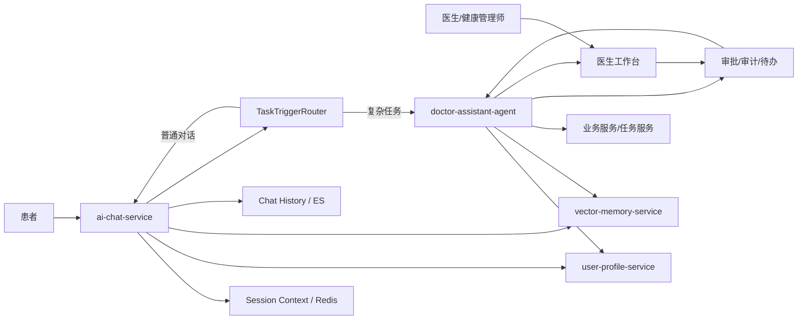

# 患者对话系统与 Agent 协同改造说明

## 1. 文档目标

本文档用于说明当前 `ai-chat-service` 与 `doctor-assistant-agent` 的推荐协同形态，并整理一份可执行的 TODO List，作为后续架构演进、需求讨论和分阶段验收的统一入口。

本文档关注的不是“把所有对话都改造成 Agent”，而是：

- 保持当前患者对话系统的稳定性与可控性
- 在复杂、高价值场景中按需引入 Agent 能力
- 形成“患者对话入口 + 智能任务编排引擎 + 医生/运营协同闭环”的系统

---

## 2. 当前系统判断

### 2.1 `ai-chat-service` 的定位

`ai-chat-service` 当前更适合作为：

`对话编排与记忆增强系统`

它已经具备以下能力基础：

- 多轮会话上下文维护
- 用户画像读取
- 长短期记忆编排
- Query Rewrite
- Prompt 分段组装
- 模型调用与流式输出
- 聊天历史持久化
- 异步记忆抽取触发
- 降级与配额治理

它当前更擅长的事情是：

- 理解患者问题
- 生成高质量连续回复
- 做轻量追问与信息补全
- 沉淀结构化上下文

它当前不应被定义为完整 Agent 的主要原因：

- 没有通用多步规划与执行闭环
- 没有通用 tool calling runtime
- 没有高风险动作审批、暂停、恢复主链路
- 目标仍以“生成更好的回复”为主，而不是“完成复杂任务”

### 2.2 `doctor-assistant-agent` 的定位

`doctor-assistant-agent` 当前更适合作为：

`任务型智能分析与执行引擎`

它已经具备或正在朝这些能力演进：

- ReAct 多步分析
- 工具调用
- 结构化结果
- 风险分级
- 审批链路
- 暂停与恢复
- 证据链
- 审计与治理

它更适合承接：

- 多步分析
- 复杂场景判断
- 结构化建议生成
- 需要审批的人机协同任务

---

## 3. 推荐目标形态

推荐的目标形态不是“全量 Agent 化患者对话”，而是：

`主对话系统 + 按需触发 Agent + 人工协同闭环`

### 3.1 核心分工

`ai-chat-service` 负责：

- 患者侧日常对话
- 上下文与画像装配
- 长短期记忆检索
- 轻量追问
- 风险初筛
- 结构化信息沉淀
- 普通问答直接回复

`doctor-assistant-agent` 负责：

- 专项任务分析
- 多步决策
- 工具调用
- 证据链整理
- 风险判断
- 随访建议生成
- 高风险任务审批链路

医生工作台/任务系统负责：

- 展示结构化结果
- 审批与驳回
- 人工接管
- 任务跟踪
- 审计查询

### 3.2 一句话架构结论

- `ai-chat-service` 负责“聊”
- `doctor-assistant-agent` 负责“办事”
- 工作台和业务服务负责“治理与执行”

---

## 4. 推荐协同架构

---

## 5. 触发边界设计

### 5.1 继续由 `ai-chat-service` 直接处理的场景

- 普通健康问答
- 日常闲聊与陪伴式对话
- 简单随访回复
- 患教内容解释
- 基础画像补全追问
- 历史信息回顾

### 5.2 升级到 `doctor-assistant-agent` 的场景

- 需要多步分析后才能得出结果
- 需要组合多个数据源形成判断
- 需要结构化分析结论而不是普通回复
- 需要创建任务、建议转人工、生成分析草稿
- 需要证据链、审计、审批
- 需要高风险场景治理

### 5.3 初期最推荐 Agent 化的场景

- 患者随访分析
- 风险分层与转人工建议
- 下一步随访动作建议

---

## 6. 核心交互链路

### 6.1 普通对话链路

1. 患者发送消息到 `ai-chat-service`
2. 系统加载画像、上下文、长短期记忆
3. 执行普通对话编排
4. 返回患者回复
5. 异步沉淀历史、记忆、画像候选信息

### 6.2 Agent 升级链路

1. 患者发送复杂消息到 `ai-chat-service`
2. `TaskTriggerRouter` 判断命中复杂任务场景
3. `ai-chat-service` 构造任务请求并调用 `doctor-assistant-agent`
4. Agent 进行多步分析、工具调用、风险判断
5. Agent 返回结构化结果
6. 对患者侧输出安全改写后的回复
7. 对医生侧输出完整结构化分析和待办信息

---

## 7. 数据契约建议

### 7.1 `ai-chat-service -> doctor-assistant-agent`

建议最小字段：

- `taskType`
- `goal`
- `customerId`
- `doctorId`
- `source`
- `patientMessage`
- `sessionContext`
- `profileSnapshot`
- `memorySnapshot`
- `constraints`

### 7.2 `doctor-assistant-agent -> ai-chat-service`

建议最小字段：

- `status`
- `taskType`
- `structuredResult`
- `patientSafeReply`
- `doctorWorkbenchPayload`
- `needsHumanReview`
- `pendingTask`

### 7.3 输出分层原则

Agent 返回内容建议天然分为三层：

- 患者可见层：`patientSafeReply`
- 专业分析层：`structuredResult`
- 内部治理层：`doctorWorkbenchPayload`

禁止把内部治理层内容直接透传给患者。

---

## 8. 安全边界

患者侧不应让 Agent 直接完成以下动作：

- 直接输出诊断结论
- 直接调整药物或处方方案
- 自动执行高风险业务动作
- 绕过医生审批
- 直接向患者暴露内部风险判断和医生侧结论

推荐策略：

- 患者侧回复必须是安全改写后的 `patientSafeReply`
- 医生侧和运营侧可看到完整结构化分析
- 高风险任务必须具备审批、审计、人工兜底

---

## 9. 推荐实施原则

1. 不做“大一统超级 Agent”
2. 保持 `ai-chat-service` 为患者交互主入口
3. 只把少量高价值复杂场景升级为 Agent
4. 先做可控闭环，再做更强自主性
5. 高风险能力永远优先走规则和人工治理

---

## 10. 分阶段 TODO List

说明：

- `[ ]` 表示未完成
- `[x]` 表示已完成
- 每项完成后直接勾选，作为阶段验收依据

### Phase 0：目标定义与边界收敛

- [ ] 明确项目目标形态为“患者对话系统 + 按需触发 Agent”，而不是全量患者对话 Agent 化
- [ ] 明确 `ai-chat-service` 的职责边界文档
- [ ] 明确 `doctor-assistant-agent` 的职责边界文档
- [ ] 明确患者侧、医生侧、运营侧三类用户的可见信息边界
- [ ] 明确哪些场景继续走普通对话，哪些场景升级到 Agent
- [ ] 明确高风险场景禁止事项清单

### Phase 1：架构与接口基线

- [ ] 在 `ai-chat-service` 中引入 `TaskTriggerRouter` 设计
- [ ] 定义 `TaskTriggerRouter` 的输入输出模型
- [ ] 定义 `ai-chat-service -> doctor-assistant-agent` 的任务请求 DTO
- [ ] 定义 `doctor-assistant-agent -> ai-chat-service` 的响应 DTO
- [ ] 约定 `taskType` 枚举及首批场景列表
- [ ] 约定 `patientSafeReply`、`structuredResult`、`doctorWorkbenchPayload` 三层输出协议
- [ ] 定义调用超时、失败重试、幂等策略

### Phase 2：首批触发规则落地

- [ ] 设计首版触发规则，优先覆盖“随访分析”
- [ ] 设计首版触发规则，覆盖“风险分层与转人工建议”
- [ ] 设计首版触发规则，覆盖“下一步随访动作建议”
- [ ] 增加“普通对话不升级”为默认分支，避免过度触发 Agent
- [ ] 增加触发原因记录字段，便于后续复盘
- [ ] 为触发判断增加可观测指标

### Phase 3：`ai-chat-service` 侧改造

- [ ] 在普通对话主链路中接入 Agent 升级判断
- [ ] 支持把会话上下文打包为 Agent 输入
- [ ] 支持把画像快照打包为 Agent 输入
- [ ] 支持把长期/短期记忆快照打包为 Agent 输入
- [ ] 增加 Agent 调用失败时的普通对话降级回复
- [ ] 增加 Agent 未命中时的纯对话回退逻辑
- [ ] 为 Agent 调用增加 tracing/correlationId

### Phase 4：`doctor-assistant-agent` 侧改造

- [ ] 为患者对话来源新增专用 `taskType` 入口
- [ ] 支持接收来自 `ai-chat-service` 的上下文快照
- [ ] 支持基于患者来源任务生成结构化分析结果
- [ ] 支持输出患者安全回复 `patientSafeReply`
- [ ] 支持输出医生侧工作台载荷 `doctorWorkbenchPayload`
- [ ] 为患者来源任务增加专门安全规则
- [ ] 为患者来源任务增加审计标识和来源标识

### Phase 5：首批专项 Agent 场景

- [ ] 落地“患者随访分析”专项 Agent
- [ ] 落地“风险分层与转人工建议”专项 Agent
- [ ] 落地“下一步随访动作建议”专项 Agent
- [ ] 为每个专项 Agent 明确输入、输出、风险级别
- [ ] 为每个专项 Agent 明确是否允许直接面向患者输出

### Phase 6：患者安全与治理

- [ ] 增加患者侧回复安全改写策略
- [ ] 增加患者侧高危症状拦截规则
- [ ] 增加患者侧禁用药物调整/诊断性直出规则
- [ ] 增加患者侧“证据不足时保守回答”规则
- [ ] 增加患者侧“必须转人工”规则
- [ ] 增加患者侧与医生侧输出隔离校验

### Phase 7：医生工作台与人机协同

- [ ] 定义医生工作台需要展示的结构化字段
- [ ] 定义医生工作台的风险等级展示方案
- [ ] 定义证据链展示方案
- [ ] 定义待审批任务展示方案
- [ ] 定义人工接管入口和状态流转
- [ ] 定义历史分析结果对比能力

### Phase 8：可观测性与审计

- [ ] 增加 Agent 升级触发率指标
- [ ] 增加 Agent 成功率、失败率、降级率指标
- [ ] 增加患者安全拦截率指标
- [ ] 增加转人工率指标
- [ ] 增加任务审批命中率和驳回率指标
- [ ] 增加普通对话与 Agent 对话的耗时对比指标
- [ ] 支持按 `conversationId/sessionId/taskId` 进行链路追踪

### Phase 9：评测与回归

- [ ] 建立普通患者对话评测集
- [ ] 建立 Agent 升级触发评测集
- [ ] 建立患者安全拒答/转人工评测集
- [ ] 建立复杂随访分析评测集
- [ ] 建立降级与超时场景评测集
- [ ] 为关键场景建立回归脚本或自动化测试

### Phase 10：上线策略

- [ ] 设计灰度开关，支持按场景启用 Agent
- [ ] 设计灰度开关，支持按用户分组启用 Agent
- [ ] 设计熔断开关，支持 Agent 故障时自动回退普通对话
- [ ] 设计仅医生侧可见的试运行模式
- [ ] 设计患者侧只读保守模式
- [ ] 明确首批上线场景与禁用场景

---

## 11. 建议优先级

推荐顺序：

1. 先完成 Phase 0 到 Phase 2
2. 再完成首批链路接入，即 Phase 3 到 Phase 5
3. 上线前重点完成 Phase 6、Phase 8、Phase 9、Phase 10

不建议一开始就做的事情：

- 一次性让所有患者对话都走 Agent
- 过早做大而全的通用任务平台
- 在患者侧直接开放高风险自动化动作

---

## 12. 最终目标

最终推荐落地形态：

- `ai-chat-service` 作为患者交互主入口
- `doctor-assistant-agent` 作为专项分析与任务编排引擎
- 医生工作台/任务系统作为治理与执行层

这条路线的目标不是“给系统贴上 Agent 标签”，而是：

`在保持患者对话系统稳定可控的前提下，让复杂场景逐步获得可治理、可审计、可协同的智能编排能力。`
