# AI Chat x Doctor Assistant Agent 整合时序图

本文档描述当前 `ai-chat-service` 与 `doctor-assistant-agent` 整合后的真实调用链路，重点覆盖：

- 会话上下文的创建、读取与更新
- 用户画像的 RabbitMQ RPC 获取
- 短期记忆与长期记忆的装载流程
- Self-Query DSL、自查询编译与下游过滤
- Redis / Milvus / Keyword 三路混合检索
- Rerank 模型接入与排序策略
- `TaskTriggerRouter` 的升级判定
- 普通对话与 Agent 升级两条分支
- Agent 安全清洗、人工复核和回退普通对话
- 对话完成后的异步历史落库与记忆提取

## 参与组件

- `AiChatController` / `AiChatService`
- `SessionContextService` + Redis
- `UserProfileClientFixed` + RabbitMQ + `user-profile-service`
- `LayeredMemoryOrchestrator` / `RetrievalQueryRewriteService` / `MemorySelfQueryPlanner` / `MemoryService`
- `VectorMemoryClientFixed` / `VectorMemoryMessageListener`
- `StructuredMemoryQueryCompiler` / `MemoryRetrievalService` / `MemoryRerankService`
- `TaskTriggerRouter` / `AgentDispatchPolicy`
- `HttpDoctorAssistantAgentGateway`
- `PatientTaskController` / `PatientTaskAgentService` / `PatientTaskSafetyService`
- `DeepSeekClient`
- `ChatAsyncProcessingService`

## 详细时序图

```mermaid
sequenceDiagram
    autonumber
    actor Patient as Patient
    participant Controller as AiChatController
    participant Chat as AiChatService
    participant Guard as ConversationExecutionGuard
    participant Quota as QuotaService
    participant Context as SessionContextService
    participant Redis as Redis
    participant Intent as DeepSeekIntentAnalyzer
    participant Profile as UserProfileClientFixed
    participant MQ as RabbitMQ
    participant ProfileSvc as user-profile-service
    participant MemoryOrch as LayeredMemoryOrchestrator
    participant Rewrite as RetrievalQueryRewriteService
    participant Filter as IntentMemoryFilterStrategy
    participant Planner as MemorySelfQueryPlanner
    participant Memory as MemoryService
    participant MemoryClient as VectorMemoryClientFixed
    participant VectorListener as VectorMemoryMessageListener
    participant Compiler as StructuredMemoryQueryCompiler
    participant VectorSvc as MemoryRetrievalService
    participant Rerank as MemoryRerankService
    participant Router as TaskTriggerRouter
    participant Policy as AgentDispatchPolicy
    participant ReqFactory as DoctorAssistantTaskRequestFactory
    participant AgentGW as HttpDoctorAssistantAgentGateway
    participant AgentCtrl as PatientTaskController
    participant AgentSvc as PatientTaskAgentService
    participant Safety as PatientTaskSafetyService
    participant LLM as DeepSeekClient
    participant Async as ChatAsyncProcessingService
    participant DB as MySQL

    Patient->>Controller: POST /api/chat
    Controller->>Chat: handleChatRequest(request)
    Chat->>Chat: ensureConversationId()
    Chat->>Chat: metrics.recordChatRequest()
    Chat->>Guard: tryExecute(conversationId, supplier)

    Guard->>Quota: checkQuota(customerId, estimatedTokens)
    Guard->>Context: getOrCreateContext(conversationId, customerId, groupId, message)
    Context->>Redis: GET ai:session:context:{conversationId}

    alt Redis 中不存在上下文
        Redis-->>Context: null
        Context->>Intent: analyzeIntentWithTimeout(message, [], 5000ms)
        alt 意图分析成功
            Intent-->>Context: SessionContext(topic, phase, intent, complexity)
        else 意图分析失败或超时
            Context->>Context: createDefaultContext()
        end
        Context->>Context: 写入 conversationId/customerId/groupId/messageCount
        Context->>Redis: SET context, TTL=30min
    else Redis 中已有上下文
        Redis-->>Context: existing SessionContext
        opt 命中重新分析条件
            Context->>Intent: analyzeIntentWithTimeout(message, recentSummaries, 5000ms)
            Intent-->>Context: updated SessionContext
            Context->>Context: mergeContextUpdate(...)
            Context->>Redis: SET refreshed context
        end
    end
    Context-->>Chat: SessionContext

    Chat->>Router: route(TaskTriggerContext)
    Router->>Router: 检查追问中 / 闲聊 / 事实问答 / 分析意图 / 风险信号 / 下一步动作
    Router-->>Chat: TaskTriggerDecision
    Chat->>Context: recordTaskTriggerDecision(conversationId, decision)
    Context->>Redis: SET lastTaskTrigger*

    par 用户画像加载
        Chat->>Profile: requestUserProfile(customerId)
        Profile->>Profile: 创建 CompletableFuture + pendingRequests
        Profile->>MQ: send user.profile.request(replyTo, correlationId)
        MQ->>ProfileSvc: 投递画像请求
        ProfileSvc-->>MQ: 画像响应
        MQ-->>Profile: ai.chat.user.profile.reply
        Profile->>Profile: future.complete(response)
        Profile-->>Chat: UserProfileDTO
    and 画像完成后装载记忆
        Chat->>MemoryOrch: loadMemories(groupId, customerId, message, sessionContext, profile, memoryEnabled, retrievalCount)
        MemoryOrch->>MemoryOrch: extractShortTermMemories(sessionContext)
        Note over MemoryOrch: 短期记忆来自 currentTopic、userIntent、pendingQuestions、recentSummaries
        alt 降级关闭记忆 or retrievalCount=0 or 当前消息不需要检索
            MemoryOrch-->>Chat: shortTermMemories only
        else 需要长期记忆检索
            MemoryOrch->>Rewrite: rewrite(message, sessionContext, profile)
            Rewrite-->>MemoryOrch: rewrittenQuery + keywords + suggested filters + optional filterExpression
            MemoryOrch->>Filter: decide(sessionContext)
            Filter-->>MemoryOrch: memoryTypes/minConfidence/recentDays
            MemoryOrch->>Planner: plan(message, retrievalQuery, filterDecision)
            Planner-->>MemoryOrch: StructuredMemoryQuery
            MemoryOrch->>Memory: retrieveMemories(groupId, customerId, structuredQuery)
            Memory->>MemoryClient: requestMemories(structuredQuery)
            MemoryClient->>VectorListener: vector.memory.request
            VectorListener->>Compiler: compile(structuredQuery, fallbackFilter)
            Compiler-->>VectorListener: MemorySearchFilter
            VectorListener->>VectorSvc: retrieveGroupMemories(effectiveQuery, groupId, customerId, topK, compiledFilter)
            Note over VectorSvc: 并行召回 Redis 最近记忆、Milvus 向量记忆、MySQL 关键词记忆
            opt rerank.enabled = true
                VectorSvc->>Rerank: rerank(...) or rerankPartial(...)
                Rerank-->>VectorSvc: reranked memories
            end
            VectorSvc-->>VectorListener: candidate memories
            VectorListener-->>MemoryClient: MemoryResponseMessage
            MemoryClient-->>Memory: candidate memories
            Memory->>Memory: similarity threshold + dedup + topK
            Memory-->>MemoryOrch: longTermMemories
            MemoryOrch-->>Chat: shortTermMemories + longTermMemories
        end
    end

    alt 画像补全追问优先触发
        Chat->>Chat: handleProfileCompletionIfNeeded(...)
        Chat->>Context: updateContext(conversationId, userMessage, "")
        Context->>Redis: GET/SET context
        Chat->>Async: handleChatCompleted(follow-up message)
        Async->>DB: 插入对话历史
        Async->>Memory: extractMemory(...)
        Chat-->>Controller: ChatResponse.success(followUpMessage)
        Controller-->>Patient: 追问消息
    else 正常进入对话或 Agent 分流
        alt shouldUpgradeToAgent = false
            Chat->>LLM: chat(request, profile, sessionContext, layeredMemories)
            LLM-->>Chat: DifyResponse(answer, usage)
            Chat->>Context: updateContext(conversationId, userMessage, aiResponse)
            Context->>Redis: GET/SET context
            Chat->>Async: handleChatCompleted(request, response, correlationId)
            Async->>DB: 保存对话历史
            Async->>MQ: 同步聊天记录到索引队列
            Async->>Memory: extractMemory(groupId, customerId, userMessage, aiResponse)
            Chat-->>Controller: ChatResponse.success(...)
            Controller-->>Patient: 普通对话回复
        else shouldUpgradeToAgent = true
            Chat->>Policy: evaluate(request, triggerDecision)
            alt 灰度未放行 or 熔断打开
                Policy-->>Chat: invokeAgent=false
                Chat->>LLM: chat(request, profile, sessionContext, layeredMemories)
                LLM-->>Chat: DifyResponse
                Chat->>Context: updateContext(...)
                Chat->>Async: handleChatCompleted(...)
                Chat-->>Controller: ChatResponse.success(direct_chat_fallback)
                Controller-->>Patient: 普通对话回退回复
            else 放行 Agent
                Policy-->>Chat: invokeAgent=true
                Chat->>ReqFactory: buildPatientDialogRequest(...)
                ReqFactory-->>Chat: DoctorAssistantTaskRequest
                Note over ReqFactory: 附带 sessionContext、profileSnapshot、memorySnapshot、triggerDecision、constraints
                Chat->>AgentGW: POST /api/patient-tasks/analyze
                AgentGW->>AgentCtrl: /api/patient-tasks/analyze
                AgentCtrl->>AgentSvc: analyze(request)
                AgentSvc->>AgentSvc: DoctorAssistantTaskRequest -> AgentExecutionCommand
                AgentSvc->>AgentSvc: 优先调用 ReActAgentEngine.executeStream(command, noopEventSink)
                AgentSvc->>AgentSvc: 预加载 sessionContext / profileSnapshot / memorySnapshot / triggerDecision
                alt 真实 Agent 返回 SUCCESS / PENDING_APPROVAL
                    AgentSvc->>AgentSvc: AgentResult -> StructuredTaskResult / PendingTask / WorkbenchPayload
                    AgentSvc->>AgentSvc: PatientReplyComposer 生成 candidatePatientReply
                    AgentSvc->>Safety: sanitize(candidatePatientReply, structuredResult, needsHumanReview)
                    Safety-->>AgentSvc: allowed or blocked
                else 真实 Agent 返回 ERROR / MAX_STEPS / null 或执行异常
                    AgentSvc->>AgentSvc: 回退模板分析链路
                    AgentSvc->>Safety: sanitize(candidatePatientReply, structuredResult, needsHumanReview)
                    Safety-->>AgentSvc: allowed or blocked
                end
                AgentSvc-->>AgentCtrl: DoctorAssistantTaskResponse
                AgentCtrl-->>AgentGW: DoctorAssistantTaskResponse
                AgentGW-->>Chat: DoctorAssistantTaskResponse

                alt Agent 返回 SKIPPED
                    Chat->>LLM: chat(request, profile, sessionContext, layeredMemories)
                    LLM-->>Chat: DifyResponse
                    Chat->>Context: updateContext(...)
                    Chat->>Async: handleChatCompleted(...)
                    Chat-->>Controller: ChatResponse.success(agent_skipped_fallback)
                    Controller-->>Patient: 普通对话回退回复
                else Agent 返回 ERROR 或 patientSafeReply 为空
                    Chat->>LLM: chat(request, profile, sessionContext, layeredMemories)
                    LLM-->>Chat: DifyResponse
                    Chat->>Context: updateContext(...)
                    Chat->>Async: handleChatCompleted(...)
                    Chat-->>Controller: ChatResponse.success(agent_error_fallback)
                    Controller-->>Patient: 普通对话回退回复
                else Agent 返回 SUCCESS / PENDING_APPROVAL
                    Chat->>Chat: buildAgentChatResponse(...)
                    Note over Chat: 如需人工复核，追加“已同步给医生进一步评估”提示
                    Chat->>Context: updateContext(conversationId, userMessage, patientSafeReply)
                    Context->>Redis: GET/SET context
                    Chat->>Async: handleChatCompleted(request, patientSafeReply, correlationId)
                    Async->>DB: 保存患者可见回复到对话历史
                    Async->>MQ: 同步聊天记录到索引队列
                    Async->>Memory: extractMemory(groupId, customerId, userMessage, patientSafeReply)
                    Note over Chat: 只把 patientSafeReply 并回患者主链路，不写入医生侧 structuredResult / workbench payload
                    Chat-->>Controller: ChatResponse.success(patientSafeReply)
                    Controller-->>Patient: 患者安全回复
                end
            end
        end
    end
```



## 关键分支说明

### 1. 会话上下文

- 首次对话时，`SessionContextService` 会先尝试从 Redis 读取上下文。
- 若上下文不存在，会调用 `DeepSeekIntentAnalyzer` 做首轮意图分析；失败则回退默认上下文。
- 后续轮次会根据 `shouldReanalyzeIntent(...)` 决定是否重新分析，并把结果写回 Redis。
- 每次任务触发判定后，还会把 `lastTaskTriggerRoute / taskType / reasons / summary` 记录到上下文里，便于复盘。

### 2. 用户画像

- `UserProfileClientFixed` 采用 RabbitMQ RPC 模式，而不是本地直连 HTTP。
- `ai-chat-service` 发送请求时会登记 `correlationId -> CompletableFuture`。
- `user-profile-service` 返回响应后，由固定 reply 队列监听器完成 future，主链路再继续。

### 3. 记忆处理

- 短期记忆不是单独调用服务，而是直接从 `SessionContext` 提取。
- 长期记忆检索由 `LayeredMemoryOrchestrator` 统一编排：
  - `RetrievalQueryRewriteService` 负责改写检索 query
  - `IntentMemoryFilterStrategy` 负责根据当前意图决定过滤策略
  - `MemorySelfQueryPlanner` 负责把 rewrite 结果和意图策略合并成 `StructuredMemoryQuery`
  - `MemoryService` 负责向 `vector-memory-service` 发请求并做上游统一相似度过滤、去重和裁剪
- 降级模式下可以完全跳过长期记忆检索。

### 3.1 Self-Query DSL

当前长期记忆检索已经从“文本 query + 几个 suggested filters”升级成“文本 query + 原生 DSL”。

当前 DSL 特征：

- 支持 `AND / OR`
- 支持 `expressions` 递归嵌套
- 支持字段：
  - `memoryType`
  - `memoryKey`
  - `memoryContent`
  - `sourceMessage`
  - `confidenceScore`
  - `verifiedOnly`
  - `recentDays`
- 支持操作符：
  - `EQ`
  - `IN`
  - `GTE`
  - `LTE`
  - `CONTAINS`

当前执行方式：

- chat 侧由 `RetrievalRewriteClient` 解析 LLM 返回的 `filterExpression`
- `StructuredMemoryQueryValidator` 做白名单校验和非法条件清洗
- vector-memory 侧由 `StructuredMemoryQueryCompiler` 编译成 `MemorySearchFilter`
- 简单过滤项可下推到 SQL
- 复杂 `OR / 嵌套 / contains` 条件由运行时 matcher 补充执行

### 3.2 混合检索

当前 `vector-memory-service` 的长期记忆召回已经是三路并行：

- Redis 最近记忆
- Milvus 向量语义检索
- MySQL 关键词检索

这三路命中会先合并，再交给去重和 rerank。

当前分数设计目标是让三路结果都能进入统一排序和阈值过滤：

- 向量检索保留原始语义相似度，允许用 `vector-scale` 做整体缩放
- Redis 最近记忆使用 `redis-base + confidence * redis-confidence-bonus`
- 关键词检索使用 `keyword-base + 命中位置 bonus + confidence bonus`

所以现在“最近上下文”和“关键词命中”即使没有 rerank，也通常不会被上游 `0.7` 阈值直接过滤掉。

### 3.3 Rerank

`MemoryRetrievalService` 在三路召回合并后，支持可选 rerank。

当前支持：

- `full`
  - 对全部候选重排
- `partial`
  - 只对缺少可靠语义分数的候选重排

当前 provider 支持：

- embedding-based rerank
- 外部 `bge-http` rerank

如果外部 rerank 失败，可以按配置回退到 embedding rerank；如果整体 rerank 失败，则保底返回原有排序结果。

### 4. Agent 升级判定

- `TaskTriggerRouter` 会优先拦截画像补全追问、闲聊、简单事实问答。
- 只有命中分析、风险分层、下一步建议等信号，才会切到 `DOCTOR_ASSISTANT_AGENT` 路由。
- 路由命中后仍不会立刻调用 Agent，还要经过 `AgentDispatchPolicy` 的灰度和熔断判断。

### 5. Agent 响应的三层输出

- `patientSafeReply`：面向患者的安全回复
- `structuredResult`：面向医生侧的结构化分析结果
- `doctorWorkbenchPayload`：面向工作台和治理系统的内部载荷

补充说明：

- `patientSafeReply` 现在不是直接从医生侧结构化结论透出
- 当前出口链路为：
  - `AgentResult`
  - `StructuredTaskResult`
  - `PatientReplyComposer` 生成候选患者文案
  - `PatientTaskSafetyService.sanitize(...)`
  - `final patientSafeReply`

### 6. Agent 成功分支现在如何并回主链路

- 普通对话分支和 Agent 成功分支现在都会执行：
  - `SessionContextService.updateContext(...)`
  - `ChatAsyncProcessingService.handleChatCompleted(...)`
  - 进而触发历史落库、索引同步、记忆提取
- 区别在于 Agent 成功分支只把 `patientSafeReply` 并回患者主链路。
- `structuredResult` 和 `doctorWorkbenchPayload` 仍然保留在医生侧/工作台侧语义中，不会进入患者上下文或记忆抽取。

补充说明：

- `doctor-assistant-agent` 当前虽然仍然对外暴露 `POST /api/patient-tasks/analyze`
- 但该入口内部已经优先进入真实 `ReActAgentEngine.executeStream(...)`
- 只有在真实 Agent 返回 `ERROR / MAX_STEPS / null` 或执行异常时，才会回退到模板分析
- 对 `ai-chat-service` 来说，外部协议不变，仍然只消费 `DoctorAssistantTaskResponse`

## 配置关注点

```yaml
ai-chat:
  agent:
    enabled: false
    base-url: ${DOCTOR_ASSISTANT_AGENT_BASE_URL:http://localhost:8088}
    timeout-ms: 8000
    auto-fallback-to-direct-chat: true
    patient-conservative-readonly-mode: true
    enabled-task-types:
      - PATIENT_FOLLOW_UP_ANALYSIS
      - RISK_STRATIFICATION_AND_ESCALATION
      - NEXT_FOLLOW_UP_ACTION_RECOMMENDATION
    enabled-group-ids: []
    circuit-breaker-open: false
```

## 推荐阅读

- [AI 服务总览](README.md)
- [患者对话 Agent 协同系统](../docs/patient-dialog-agent/README.md)
- [AI Chat Flow 详解](ai-chat-service/README-CHAT-FLOW.md)
