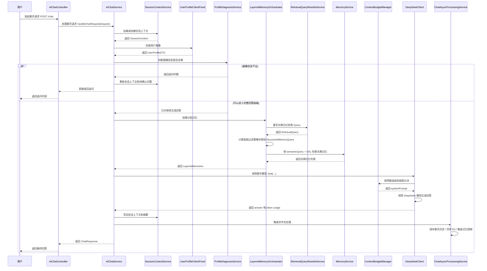

# AI Chat Service 流程说明

## 概述

`ai-chat-service` 是对话编排层，负责把用户问题、会话上下文、用户画像、短期记忆、长期记忆和模型调用串成一条完整响应链路。

它本身**不负责**正式用户画像存储，也**不负责**正式长期记忆存储。它的职责主要是：

- 加载稳定画像信息，用户画像回答“这个人长期是什么样的人”
- 维护会话级上下文
- 判断是否需要检索
- 重写检索 Query
- 编排短期记忆与长期记忆，短期记忆直接从redis中获取、长期记忆从向量库中走。长期记忆回答“这个人最近发生过什么、说过什么、试过什么、变化成什么样”
- 组装 Prompt
- 调用 DeepSeek 生成回答
- 异步触发下游持久化和记忆抽取

当前上下游依赖：

- `user-profile-service`：正式画像来源与 Redis 画像缓存
- `vector-memory-service`：长期记忆检索、候选态记忆处理
- Redis：会话上下文缓存
- MySQL：聊天历史持久化
- Elasticsearch：聊天历史搜索与推荐
- RabbitMQ：RPC 调用与异步提取触发

## 当前主流程

### 1. 会话上下文加载

入口：

- `AiChatService.handleChatRequest(...)`
- `AiChatStreamService.handleChatStreamRequest(...)`

会话上下文由 `SessionContextService` 负责。

当前行为：

- key 前缀：`ai:session:context:`
- 存储格式：Redis String(JSON)，不是 Redis Hash
- 首次消息会触发 `DeepSeekIntentAnalyzer` 做意图分析
- 后续轮次在话题漂移或时间间隔较大时会重新分析，切换关键词或者常见时间没有回复，或者数量超过一定阈值后。

当前会话上下文字段主要包括：

- `currentTopic`
- `userIntent`
- `conversationPhase`
- `complexity`
- `recentSummaries`
- `pendingQuestions`

这部分是当前会话的短生命周期运行态，不是长期记忆。

### 2. 用户画像加载

`ai-chat-service` 通过 RabbitMQ RPC 调用 `UserProfileClientFixed` 拉取用户画像。

正式画像的缓存和构建逻辑在 `user-profile-service` 中。

当前画像特征：

- Redis Hash 存储
- key 前缀：`ai:profile:`
- 正式数据源仍然在 `user-profile-service` 管理的业务表中

### 3. 画像诊断

在生成回答之前，`ProfileDiagnosisService` 会判断当前画像字段是否足够支撑本轮回答。

当前行为：

- 如果画像信息不足，会生成追问问题
- 追问内容会写回会话上下文
- 当前轮可能直接返回追问，而不进入完整回答链路

这一步目前是实用型字段补全门控，不是完整的画像候选态处理逻辑。画像候选态已经下沉到 `user-profile-service`。

### 4. 检索决策

记忆检索不是每轮都执行。

当前决策依据：

- `MessageValidator.shouldRetrieveMemories(...)`
- 会话 `complexity`
- 降级开关

如果判断不需要检索：

- 只使用画像和会话上下文
- 不触发长期记忆召回

### 5. Query Rewrite

如果需要长期记忆检索，会先经过 `RetrievalQueryRewriteService` 做检索 Query 重写。

当前策略：

- 基线规则重写
- 复杂问题优先触发 LLM rewrite
- 对“短追问 / 指代明显 / 强依赖上下文”的消息，也可以触发 LLM rewrite
- LLM 输出无效时回退到规则版

当前输入：

- 当前消息
- 当前话题
- 用户意图
- 最近摘要
- 少量核心画像提示

当前输出：

- `rewrittenQuery`
- `rewriteSource`，可区分 `BYPASS / RULE / LLM / FALLBACK_RULE`
- `rewriteReason`
- 可选 `keywords`
- 可选 `suggestedMemoryTypes`
- 可选 `suggestedMinConfidence`
- 可选 `suggestedVerifiedOnly`
- 可选 `suggestedRecentDays`
- `contextDependent`
- 可选 `filterExpression`

这样可以避免直接拿原始口语消息去做长期记忆召回。

当前最新变化：

- `RetrievalRewriteClient` 已经支持让 LLM 直接输出原生 `filterExpression` JSON
- `filterExpression` 不再只是扁平过滤，而是支持 `AND / OR / expressions` 形式的嵌套表达式树
- 当前允许模型产出的 metadata 字段包括：
  - `memoryType`
  - `memoryKey`
  - `memoryContent`
  - `sourceMessage`
  - `confidenceScore`
  - `verifiedOnly`
  - `recentDays`
- 当前允许的操作符包括：
  - `EQ`
  - `IN`
  - `GTE`
  - `LTE`
  - `CONTAINS`

这意味着 Query Rewrite 现在已经不只是“改写一段检索文本”，而是开始产出一个更完整的 self-query 检索计划。

### 5.1 Self-Query 规划

这是最近新增的一个关键层。

在 `RetrievalQueryRewriteService` 之后，`LayeredMemoryOrchestrator` 不会再直接把 `rewrittenQuery + suggestedFilters` 原样下发，而是会交给 `MemorySelfQueryPlanner` 和 `StructuredMemoryQueryValidator` 做一次结构化收口。

当前职责拆分：

- `MemorySelfQueryPlanner`
  - 合并 rewrite 结果和 `IntentMemoryFilterStrategy` 的基础过滤策略
  - 统一产出 `StructuredMemoryQuery`
  - 当 LLM 没有直接给出复杂 DSL 时，自动补一份扁平 `AND` 表达式
- `StructuredMemoryQueryValidator`
  - 对字段名、操作符和值做白名单校验
  - 对 `memoryType / confidenceScore / verifiedOnly / recentDays` 做归一化与裁剪
  - 对非法子句进行剔除
  - 兜底生成一个可执行的兼容表达式

当前 `StructuredMemoryQuery` 的核心组成包括：

- `originalMessage`
- `semanticQuery`
- `keywords`
- `filter`
- `filterExpression`
- `planSource`
- `planReason`
- `contextDependent`

### 6. 分层记忆编排

这是当前版本最重要的改动之一。

`LayeredMemoryOrchestrator` 将记忆拆成两层：

#### 短期记忆

直接从 `SessionContext` 提炼，不走向量检索。

当前来源：

- 当前话题
- 用户意图
- 待确认问题
- 最近几轮摘要

特点：

- 成本低
- 强相关
- 强依赖当前 session

#### 长期记忆

通过 `MemoryService` 调用 `vector-memory-service` 加载。

当前行为：

- 检索 Query 来自 `RetrievalQueryRewriteService`
- 支持按意图动态生成长期记忆过滤策略
- 会把 rewrite 结果里的建议过滤信号和意图策略合并
- 合并后不再只传简单字段，而是统一落成 `StructuredMemoryQuery`
- `semanticQuery` 会和 `keywords` 合并成最终检索文本
- 当前已支持的过滤项包括：
  - `memoryType`
  - `minConfidence`
  - `verifiedOnly`
  - `recentDays`

当前意图过滤策略已覆盖：

- 用药类
- 饮食类
- 运动类
- 症状类
- 默认通用类

当前限制：

- `ai-chat-service` 已经会传递结构化自查询条件
- 下游目前对简单固定过滤支持 SQL 下推
- 对 `OR / 嵌套表达式 / 文本 contains` 这类复杂条件，主要由 `vector-memory-service` 在召回后做运行时补充过滤

### 6.1 长期记忆检索链路的最新形态

当前长期记忆检索已经从“单一路径向量召回”升级为“多路召回 + 统一过滤 + 可选 rerank”。

当前主链路如下：

1. `LayeredMemoryOrchestrator` 产出 `StructuredMemoryQuery`
2. `MemoryService` 通过 `VectorMemoryClientFixed` 把 `semanticQuery + fixed filter + filterExpression` 一起发给 `vector-memory-service`
3. `VectorMemoryMessageListener` 调用 `StructuredMemoryQueryCompiler`
4. `StructuredMemoryQueryCompiler` 把 DSL 编译成下游 `MemorySearchFilter`
5. `MemoryRetrievalService` 执行混合检索
6. 命中候选先合并、去重，再进入 rerank 或直接排序
7. 结果回到 `ai-chat-service` 后，再经过上游统一相似度阈值过滤和裁剪

这里最关键的一点是：`ai-chat-service` 的 `0.7` 阈值不是底层召回的唯一阈值，而是上游对所有召回结果再做一次统一质量门控。

### 6.2 混合检索

当前 `vector-memory-service` 已经不是只查 Milvus。

目前长期记忆召回由三路组成：

- Redis 最近记忆
  - 来源于最近确认写入的记忆索引
  - 目标是把“近期对话上下文”稳定带上来
- Milvus 向量检索
  - 主语义召回路径
  - 保留原始语义相似度，并只允许通过 `vector-scale` 做整体缩放
- MySQL 关键词检索
  - 补足向量检索可能漏掉的显式字段命中
  - 主要覆盖 `memoryKey / memoryType / memoryContent` 等文本命中

这三路召回的候选会先进入统一去重，再决定是否 rerank。

### 6.3 三路召回分数如何落地

当前分数不是各自独立随便返回，而是都被归一化到了可比较区间，目的是让上游统一阈值过滤能真正成立。

- Milvus 向量检索
  - 使用原始语义相似度
  - 只允许通过 `vector-scale` 做整体缩放
  - 默认仍然是最可信的主分
- Redis 最近记忆
  - 不再返回 `0.0`
  - 当前采用 `redis-base + confidence * redis-confidence-bonus`
  - 默认会落在大约 `0.78` 到 `0.90`
- 关键词检索
  - 当前采用 `keyword-base` 打底
  - 再叠加精确命中、`memoryKey / memoryType` 命中、`memoryContent` 命中和少量 `confidence` 加分
  - 默认通常也会落在 `0.74+`
- Redis 解决“最近刚说过、时间很近、这轮大概率还要接着用”的内容
- 向量库解决“用户这轮在语义上真正想找什么历史经验/事实”的内容
- 关键词解决“明确字段、专有词、短语、固定表达”的内容

当前整体经验仍然是：

- `vector >= redis > keyword`
- 三路尽量都保持在 `0.7+`

原因是 `ai-chat-service` 仍然会在召回结果返回后，再按统一相似度阈值做二次过滤。

### 6.4 Rerank

Rerank 已经正式接入到 `vector-memory-service` 的召回链路中。

当前策略：

- `rerank.enabled = false`
  - 直接按当前相似度排序
- `rerank.enabled = true`
  - 进入 `MemoryRerankService`
  - 支持 `full` 和 `partial` 两种策略

两种策略的区别：

- `full`
  - 对所有候选重新打分
  - 更适合追求排序质量的场景
- `partial`
  - 只对缺少可靠语义分数的候选重打分
  - 当前更适合混合检索默认路径

当前 provider 也支持两种来源：

- embedding 本地重打分
- 外部 `bge-http` rerank 服务

当前降级逻辑：

- 外部 BGE 调用失败时，可按配置回退到 embedding-based rerank
- rerank 整体失败时，保底返回原始候选顺序的 topK

### 7. Prompt 组装

当前 Prompt 由 `DeepSeekClient` 和 `ContextBudgetManager` 共同构建。

当前实现已经从“集中式大类拼接”演进为 section pipeline。

当前结构：

- `ContextBudgetManager` 负责预算分配、section 顺序控制、token 统计
- `PromptSectionBuilder` 负责单个区块构建
- `PromptSectionSupport` 负责复用格式化、压缩、token 估算等能力

系统提示词目前会按预算编排这些区块：

- 核心画像
- 会话上下文
- 短期记忆区块
- 长期记忆区块
- 兼容旧链路的相关历史记忆区块
- 对话历史
- 可选扩展画像

当前已实现的关键点：

- 每个 section 都可以独立构建和测试
- 总装配器只负责预算和顺序控制
- 短期记忆和长期记忆已经分成不同的 Prompt 区块
- 非分层旧链路仍可走“相关历史记忆”兼容区块

当前默认顺序：

1. 核心画像
2. 会话上下文
3. 短期记忆
4. 长期记忆或兼容相关历史记忆
5. 对话历史
6. 扩展画像

### 8. DeepSeek 回答生成

`DeepSeekClient` 会向模型发送：

- 系统提示词
- 当前用户问题

支持两种模式：

- 普通回答：`chat(...)`
- 流式回答：`chatStream(...)`

### 9. 会话上下文更新

回答完成后：

- 会话上下文会写回 Redis
- 最近摘要和运行态字段会更新

这样可以保证下一轮对话的连续性，而不需要把每一轮都写入向量记忆。

### 10. 异步持久化与提取触发

回答结束后：

- 聊天历史写入 MySQL
- 可选同步到 Elasticsearch
- 异步触发记忆提取

这个异步提取不会在 `ai-chat-service` 内直接把长期记忆落成正式态，而是交给下游服务处理。

## 长期记忆现状

长期记忆已经不再是“提取后直接写正式记忆”。

当前 `vector-memory-service` 已经支持候选态流程：

- `CANDIDATE`
- `CONFIRMED`
- `REJECTED`
- `CONFLICT`

当前下游行为：

- 抽取出的记忆先进入候选处理
- 冲突会记录到冲突表
- 重复命中的候选可自动升级为 `CONFIRMED`
- 支持人工确认和人工驳回
- `CONFIRMED` 后会真正写入：
  - 正式长期记忆表
  - Milvus
  - Redis 最近记忆索引

这套候选态机制在 `vector-memory-service` 中，不在 `ai-chat-service` 内部。

## 画像候选态现状

正式画像也不再只是“从业务表构建后缓存”。

当前 `user-profile-service` 已经支持字段级候选态：

- 字段级 `CANDIDATE`
- 字段级 `CONFLICT`
- 字段级 `REJECTED`
- 字段级 `CONFIRMED`

当前下游行为：

- 确认后的候选字段会回写正式画像数据源
- 当前已支持回写：
  - `basic.*`
  - `health.*`
  - `behavior.*`
- 确认后会刷新 Redis 画像缓存

这套画像候选态机制在 `user-profile-service` 中，不在 `ai-chat-service` 内部。

## 当前架构摘要

```text
用户消息
  -> 会话上下文加载/更新
  -> 用户画像 RPC 加载
  -> 画像诊断
  -> 是否需要检索的判断
  -> 检索 Query 重写
  -> Self-Query 规划与校验
  -> 短期记忆直接提炼
  -> 长期记忆过滤策略决策与合并
  -> 长期记忆通过 vector-memory-service 做 Redis/Milvus/Keyword 混合召回
  -> 可选 rerank
  -> 上游统一阈值过滤与裁剪
  -> section pipeline Prompt 组装
  -> DeepSeek 生成回答
  -> 聊天历史异步持久化
  -> 记忆提取异步触发
```

## 当前已经实现的能力

- 会话上下文加载与更新
- 用户画像 RPC 拉取
- 画像补全追问
- 检索开关判断
- 检索 Query Rewrite
- `RULE / LLM / FALLBACK_RULE / BYPASS` 区分与监控
- LLM 原生 `filterExpression` 输出
- Self-Query DSL 规划、校验与下发
- `AND / OR / 嵌套表达式` 支持
- 短期/长期记忆分层编排
- 按意图动态设置长期记忆过滤策略
- Redis / Milvus / Keyword 三路混合召回
- 三路召回统一分数归一化
- Rerank 接入，支持 `full / partial`
- 外部 BGE rerank provider 接入与降级
- Prompt 中短期记忆与长期记忆分块
- Prompt section pipeline 化
- `vector-memory-service` 长期记忆元数据过滤
- 长期记忆候选态下游处理
- 画像候选态下游处理

## 当前仍然有限的部分

- 流式链路还没有接入真实画像拉取
- 流式链路完成后还没有把完整 assistant 响应写回会话上下文
- 复杂 DSL 目前仍以“简单条件 SQL 下推 + 复杂条件运行时补充过滤”为主
- 极复杂表达式场景下，后过滤可能会让初始召回 `fetchCount` 仍有继续放大的空间
- 流式链路与普通链路在最新自查询与 rerank 路径上的可观测性还可以继续加强
- 记忆冲突与画像冲突目前还是第一版实现，不是完整语义冲突系统

## 相关代码入口

- [AiChatService.java](/Users/lejinbo/LLM/code-snippets/governance-suite/ai/ai-chat-service/src/main/java/com/lx/governance/aichat/service/AiChatService.java:1)
- [AiChatStreamService.java](/Users/lejinbo/LLM/code-snippets/governance-suite/ai/ai-chat-service/src/main/java/com/lx/governance/aichat/service/AiChatStreamService.java:1)
- [SessionContextService.java](/Users/lejinbo/LLM/code-snippets/governance-suite/ai/ai-chat-service/src/main/java/com/lx/governance/aichat/service/SessionContextService.java:1)
- [RetrievalQueryRewriteService.java](/Users/lejinbo/LLM/code-snippets/governance-suite/ai/ai-chat-service/src/main/java/com/lx/governance/aichat/service/RetrievalQueryRewriteService.java:1)
- [LayeredMemoryOrchestrator.java](/Users/lejinbo/LLM/code-snippets/governance-suite/ai/ai-chat-service/src/main/java/com/lx/governance/aichat/service/LayeredMemoryOrchestrator.java:1)
- [MemorySelfQueryPlanner.java](/Users/lejinbo/LLM/code-snippets/governance-suite/ai/ai-chat-service/src/main/java/com/lx/governance/aichat/service/MemorySelfQueryPlanner.java:1)
- [StructuredMemoryQueryValidator.java](/Users/lejinbo/LLM/code-snippets/governance-suite/ai/ai-chat-service/src/main/java/com/lx/governance/aichat/service/StructuredMemoryQueryValidator.java:1)
- [IntentMemoryFilterStrategy.java](/Users/lejinbo/LLM/code-snippets/governance-suite/ai/ai-chat-service/src/main/java/com/lx/governance/aichat/service/IntentMemoryFilterStrategy.java:1)
- [VectorMemoryClientFixed.java](/Users/lejinbo/LLM/code-snippets/governance-suite/ai/ai-chat-service/src/main/java/com/lx/governance/aichat/client/VectorMemoryClientFixed.java:1)
- [ContextBudgetManager.java](/Users/lejinbo/LLM/code-snippets/governance-suite/ai/ai-chat-service/src/main/java/com/lx/governance/aichat/context/ContextBudgetManager.java:1)
- [PromptSectionBuilder.java](/Users/lejinbo/LLM/code-snippets/governance-suite/ai/ai-chat-service/src/main/java/com/lx/governance/aichat/context/PromptSectionBuilder.java:1)
- [PromptSectionSupport.java](/Users/lejinbo/LLM/code-snippets/governance-suite/ai/ai-chat-service/src/main/java/com/lx/governance/aichat/context/PromptSectionSupport.java:1)
- [DeepSeekClient.java](/Users/lejinbo/LLM/code-snippets/governance-suite/ai/ai-chat-service/src/main/java/com/lx/governance/aichat/client/DeepSeekClient.java:1)

## chat 调用时序图


