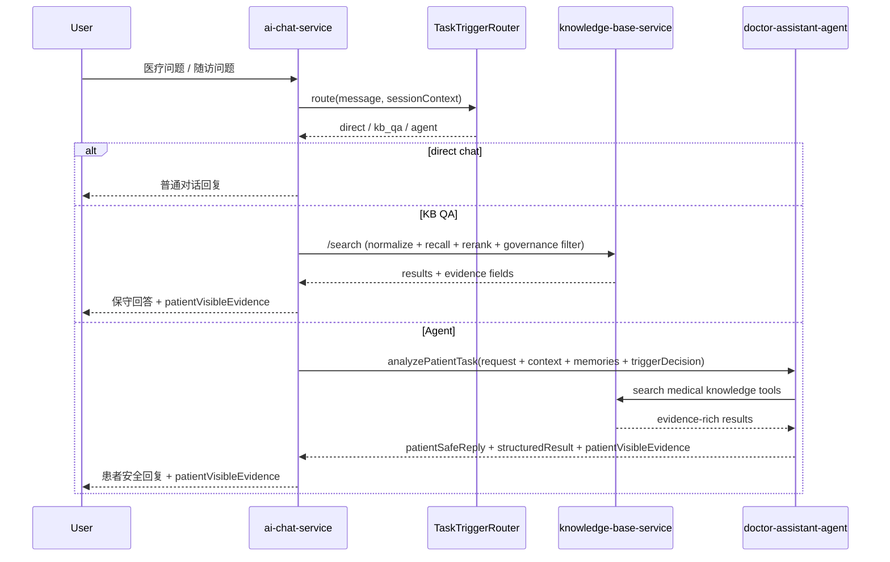

# AI Chat x Doctor Assistant Agent 整合时序图

本文档描述当前 `ai-chat-service` 与 `doctor-assistant-agent` 整合后的真实调用链路，重点覆盖：

- 会话上下文的创建、读取与更新
- 用户画像的 RabbitMQ RPC 获取
- 短期记忆与长期记忆的装载流程
- Self-Query DSL、自查询编译与下游过滤
- Redis / Milvus / Keyword 三路混合检索
- Rerank 模型接入与排序策略
- `TaskTriggerRouter` 的升级判定
- 普通对话与 Agent 升级两条分支
- Agent 安全清洗、人工复核和回退普通对话
- 对话完成后的异步历史落库与记忆提取

## 最新版医疗搜推链路摘要

当前医疗链路已经从原来的 `direct chat / agent` 二分流，扩展为更贴近生产的三级路径：

1. `direct chat`
   - 普通闲聊、画像补全追问、非医疗事实解释
2. `KB QA`
   - `TaskTriggerRouter` 命中 `medical_knowledge_qa`
   - `ai-chat-service` 调 `knowledge-base-service`
   - 走 `query normalize -> rewrite -> multi-recall -> rerank -> governance filter`
   - 返回患者保守回复 + `patientVisibleEvidence`
3. `Agent`
   - 高风险关键词
   - 医疗安全敏感事实问题（停药、加减量、急症等）
   - 趋势分析 / 下一步建议 / 风险复核
   - `doctor-assistant-agent` 可再调用：
     - `search_medical_knowledge`
     - `search_medication_guidance`
     - `search_follow_up_protocol`
     - `search_red_flag_guideline`

新增的关键差异：

- `ai-chat-service` 已支持 `direct chat -> KB QA -> Agent` 三级渐进式升级
- `knowledge-base-service` 已支持 `vector + keyword + lexicon + FAQ exact` 多路召回
- 检索结果默认带 `title / snippet / source / trustLevel / hitReason / score`
- 患者可见证据卡片已贯通 `knowledge-base-service -> doctor-assistant-agent -> ai-chat-service`
- 待审文档、失效文档、低 trust 文档会在患者链路默认抑制或降权
- 患者侧 KB QA 统一追加 disclaimer，并对停药/处方/急症问题优先升级 Agent

## 最新版医疗链路时序



## 参与组件

- `AiChatController` / `AiChatService`
- `SessionContextService` + Redis
- `UserProfileClientFixed` + RabbitMQ + `user-profile-service`
- `LayeredMemoryOrchestrator` / `RetrievalQueryRewriteService` / `MemorySelfQueryPlanner` / `MemoryService`
- `VectorMemoryClientFixed` / `VectorMemoryMessageListener`
- `StructuredMemoryQueryCompiler` / `MemoryRetrievalService` / `MemoryRerankService`
- `TaskTriggerRouter` / `AgentConversationRouteRuntime` / `AgentDispatchPolicy`
- `HttpDoctorAssistantAgentGateway`
- `PatientTaskController` / `PatientTaskAgentService` / `PatientTaskSafetyService`
- `DeepSeekClient`
- `ChatAsyncProcessingService`

## 核心类图

如果只看主链路里真正承接数据流转的核心类，可以优先关注下面这几组：

- 会话与分流
  - `SessionContext`
  - `MessageSummary`
  - `TaskTriggerDecision`
- 记忆检索
  - `RetrievalQuery`
  - `StructuredMemoryQuery`
  - `LayeredMemories`
  - `MemoryItemDTO`
- Agent 跨服务请求/响应
  - `DoctorAssistantTaskRequest`
  - `AgentTaskConstraints`
  - `DoctorAssistantTaskResponse`
  - `StructuredTaskResult`
  - `DoctorAssistantPendingTaskPayload`

```mermaid
classDiagram
    class SessionContext {
        +String conversationId
        +String customerId
        +String userId
        +String groupId
        +String tenantId
        +String currentTopic
        +String conversationPhase
        +List~String~ mentionedEntities
        +Map~String,Object~ extractedData
        +List~MessageSummary~ recentSummaries
        +String userIntent
        +List~String~ pendingQuestions
        +String complexity
        +Long sessionStartTime
        +Long lastUpdateTime
        +Integer messageCount
        +TaskTriggerRoute lastTaskTriggerRoute
        +TaskType lastTaskType
        +List~TaskTriggerReason~ lastTaskTriggerReasons
        +String lastTaskTriggerSummary
        +Long lastTaskTriggerAt
        +String lastAgentReviewStatus
        +Long lastAgentPendingTaskId
        +String lastAgentExecutionPath
        +Long lastAgentOutcomeAt
    }

    class MessageSummary {
        +String userMessage
        +Long timestamp
    }

    class UserProfileDTO {
        +Map~String,Object~ basicInfo
        +Map~String,Object~ healthProfile
        +Map~String,Object~ behaviorPreferences
        +List~Map~String,Object~~ globalMemories
    }

    class TaskTriggerDecision {
        +TaskTriggerRoute route
        +TaskType taskType
        +List~TaskTriggerReason~ reasons
        +String summary
        +boolean shouldUpgradeToAgent()
    }

    class RetrievalQuery {
        +String originalMessage
        +String rewrittenQuery
        +String rewriteSource
        +String rewriteReason
        +List~String~ keywords
        +Set~String~ suggestedMemoryTypes
        +Double suggestedMinConfidence
        +Boolean suggestedVerifiedOnly
        +Integer suggestedRecentDays
        +Boolean contextDependent
        +StructuredMemoryQuery structuredQuery
    }

    class StructuredMemoryQuery {
        +String originalMessage
        +String semanticQuery
        +List~String~ keywords
        +MemoryFilter filter
        +FilterExpression filterExpression
        +String planSource
        +String planReason
        +Boolean contextDependent
    }

    class MemoryFilter {
        +Set~String~ memoryTypes
        +Double minConfidence
        +Boolean verifiedOnly
        +Integer recentDays
    }

    class FilterExpression {
        +String operator
        +List~FilterClause~ clauses
        +List~FilterExpression~ expressions
    }

    class FilterClause {
        +String field
        +String op
        +List~String~ values
    }

    class LayeredMemories {
        +List~String~ shortTermMemories
        +List~MemoryItemDTO~ longTermMemories
    }

    class MemoryItemDTO {
        +Long id
        +String content
        +Double similarity
        +Double confidenceScore
        +Boolean verified
        +String source
    }

    class DoctorAssistantTaskRequest {
        +TaskType taskType
        +String goal
        +String customerId
        +String doctorId
        +String patientMessage
        +String conversationId
        +String correlationId
        +SessionContext sessionContext
        +UserProfileDTO profileSnapshot
        +LayeredMemories memorySnapshot
        +TaskTriggerDecision triggerDecision
        +AgentTaskConstraints constraints
    }

    class AgentTaskConstraints {
        +Boolean patientVisibleResponseOnly
        +Boolean requireHumanReviewForHighRisk
        +Boolean requireEvidence
        +Boolean requireAuditTrail
        +Boolean fallbackToDirectChatOnFailure
        +Integer timeoutMillis
        +String idempotencyKey
    }

    class DoctorAssistantTaskResponse {
        +String agentSessionId
        +String taskId
        +String conversationId
        +String correlationId
        +DoctorAssistantTaskStatus status
        +TaskType taskType
        +String patientSafeReply
        +StructuredTaskResult structuredResult
        +DoctorAssistantPendingTaskPayload pendingTask
        +String executionPath
        +String agentExecutionStatus
        +String fallbackReason
        +Boolean needsHumanReview
        +String errorMessage
    }

    class StructuredTaskResult {
        +String summary
        +String riskLevel
        +Boolean needsAttention
        +List~String~ keyFindings
        +List~String~ recommendedActions
        +List~String~ uncertainties
        +List~String~ supportingEvidence
        +List~String~ evidenceSources
        +List~String~ inferences
    }

    class DoctorAssistantPendingTaskPayload {
        +Long pendingTaskId
        +String agentSessionId
        +String toolName
        +String toolDescription
        +String reason
        +String status
        +String reviewComment
        +Long expireAt
    }

    SessionContext --> MessageSummary : recentSummaries
    RetrievalQuery --> StructuredMemoryQuery : structuredQuery
    StructuredMemoryQuery --> MemoryFilter : filter
    StructuredMemoryQuery --> FilterExpression : filterExpression
    FilterExpression --> FilterClause : clauses
    FilterExpression --> FilterExpression : expressions
    LayeredMemories --> MemoryItemDTO : longTermMemories
    DoctorAssistantTaskRequest --> SessionContext : sessionContext
    DoctorAssistantTaskRequest --> UserProfileDTO : profileSnapshot
    DoctorAssistantTaskRequest --> LayeredMemories : memorySnapshot
    DoctorAssistantTaskRequest --> TaskTriggerDecision : triggerDecision
    DoctorAssistantTaskRequest --> AgentTaskConstraints : constraints
    DoctorAssistantTaskResponse --> StructuredTaskResult : structuredResult
    DoctorAssistantTaskResponse --> DoctorAssistantPendingTaskPayload : pendingTask
```




## 当前系统里的 AI 调用小目录

这一节只回答一个问题：当前系统里，哪些步骤真的调用了 AI 模型，它们各自负责什么，以及核心参数应该怎么配。

小目录：

- `ai-chat-service`
  - 意图分析
  - 检索 query rewrite
  - 普通对话 / 流式回答
- `vector-memory-service`
  - embedding
  - rerank
  - 长期记忆提取
- `doctor-assistant-agent`
  - ReAct 推理
  - 流式执行与最终收口
- `knowledge-base-service`
  - 查询改写
  - 检索重排
  - 元数据抽取 / 语义去重判定
- 非 AI 步骤说明

### 1. `ai-chat-service` 里哪些步骤用了 AI

1. 意图分析：`DeepSeekIntentAnalyzer`
   - 作用：
     - 把当前用户消息和最近若干轮摘要转成 `SessionContext`
     - 产出 `currentTopic / userIntent / pendingQuestions / complexity`
     - 给后续的画像补全、记忆检索、Agent 升级判定提供入口标签
   - 现在的实现方式：
     - 通过 `DeepSeekIntentAnalyzer -> DeepSeekClient.chat(...)` 间接走主聊天模型
     - 当前实际复用了主聊天的 `temperature=0.7`
   - 更合理的参数建议：
     - `temperature: 0.0 ~ 0.2`
     - `maxTokens: 300 ~ 600`
   - 为什么这么配：
     - 这是分类和结构化抽取任务，目标是稳定、可重复，不是创造性表达
     - 温度太高会让 `userIntent / complexity / pendingQuestions` 抖动，直接影响后续路由

2. 记忆检索改写：`RetrievalRewriteClient`
   - 作用：
     - 把用户口语问题改写成适合长期记忆召回的短 query
     - 同时产出 `keywords / filterExpression / suggestedMemoryTypes / minConfidence / recentDays`
     - 本质上是在“检索前”把 query 结构化
   - 当前实现参数：
     - `temperature: 0.0`
     - `maxTokens: 64`
     - `maxQueryLength: 80`
   - 这套参数是合理的：
     - rewrite 任务最怕发散和话多
     - `0.0` 可以尽量稳定，`64` 足够覆盖短 query 和轻量 JSON 输出

3. 普通对话生成：`DeepSeekClient.chat(...) / chatStream(...)`
   - 作用：
     - 结合 `system prompt + 当前问题 + 画像 + sessionContext + layeredMemories`
     - 生成患者可见回复
     - 是主链路里最核心的一次模型调用
   - 当前实现参数：
     - `model: deepseek-v4-pro`
     - `temperature: 0.7`
     - `maxTokens: 2000`
   - 参数建议：
     - `temperature: 0.5 ~ 0.7`
     - `maxTokens: 1200 ~ 2000`
   - 为什么这么配：
     - 患者对话需要自然度和可读性，不能像分类器那样压到 `0.0`
     - 但医疗场景也不能太发散，所以一般不建议再往 `0.8+` 走
     - `maxTokens` 太大容易拉长 RT 和成本，太小又容易截断解释型回答

### 2. `vector-memory-service` 里哪些步骤用了 AI

1. 向量化：`EmbeddingService`
   - 作用：
     - 给 query、memory content 生成 embedding
     - 支撑 Milvus 向量检索、语义去重、embedding-based rerank
   - 当前实现参数：
     - `model: text-embedding-v3`
     - `dimension: 1024`
   - 配置建议：
     - embedding 模型一旦选定，维度必须和 Milvus collection 严格一致
     - 不存在 `temperature` 这类采样参数，核心是模型版本、维度、批量大小、超时和重试
   - 为什么这么配：
     - 这一层追求的是语义空间稳定，不是文本生成

2. 记忆重排：`MemoryRerankService`
   - 作用：
     - 对三路召回合并后的候选记忆做二次排序
     - 让“和当前问题最相关”的记忆排到前面
   - 当前实现有两类 provider：
     - `embedding`
       - 用 query embedding 和 memory embedding 算余弦相似度
     - `bge-http`
       - 调外部 `bge-reranker-v2-m3`
   - 配置建议：
     - 默认 `strategy: partial`
     - 默认 provider 优先 `embedding` 或 `bge-http + fallback-to-embedding=true`
   - 为什么这么配：
     - `partial` 先只修正 Redis 最近记忆，性价比通常最高
     - 全量 rerank 相关性更强，但 RT 和成本也更高
     - rerank 不是生成任务，所以也没有 `temperature`

3. 长期记忆提取：`MemoryExtractionService -> DeepSeekService.extractMemories(...)`
   - 作用：
     - 在对话完成后异步抽取长期可沉淀的稳定信息
     - 输出 `preference / health / goal / fact / context`
   - 当前实现参数：
     - `temperature: 0.1`
     - `topP: 0.8`
     - `n: 1`
     - `presencePenalty: 0.0`
     - `frequencyPenalty: 0.0`
     - `maxTokens: 600`
   - 这套参数基本就是推荐值：
     - 记忆提取是结构化抽取任务，应该极度保守
     - 低温度、单候选、有限输出长度，能显著减少模型脑补和重复波动

### 3. `doctor-assistant-agent` 里哪些步骤用了 AI

1. ReAct 推理：`doctor-assistant-agent` 的 `DeepSeekClient`
   - 作用：
     - 接收 `sessionContext / profileSnapshot / memorySnapshot / triggerDecision / tool schema`
     - 让 Agent 逐步决定下一步是：
       - 继续思考
       - 调哪个工具
       - 是否需要人工复核
       - 最终如何生成患者可见回答
   - 当前实现参数：
     - `model: deepseek-chat`
     - `temperature: 0.7`
     - `maxTokens: 2000`
     - `request-timeout: 5s`
     - `max-retries: 2`
   - 当前配置能跑，但从工程角度看偏“单档位”
   - 更推荐的拆法是：
     - 规划 / 工具选择阶段：`temperature: 0.1 ~ 0.3`
     - 最终患者回复阶段：`temperature: 0.4 ~ 0.6`
   - 为什么这么配：
     - ReAct 的 thought / action decision 更像协议决策，应该稳定
     - 患者可见收口回复可以稍微自然一点，但也不宜太高
   - 如果暂时只能保留一个统一温度：
     - 建议优先降到 `0.4 ~ 0.5`
     - 比统一 `0.7` 更适合工具编排和医疗风险场景

2. 流式执行与收口：`chatStream(...)`
   - 作用：
     - 在 Agent 流式执行中把模型增量结果持续推给上游
     - 最后收口为 `patientSafeReply / structuredResult / pendingTask`
   - 参数建议：
     - 和普通 Agent chat 保持同一模型版本
     - 不要因为是 stream 就单独把温度调高
   - 为什么这么配：
     - stream 只是输出形态变化，不是任务目标变化

### 4. `knowledge-base-service` 里哪些步骤用了 AI

这一部分不是 `AI Chat x Doctor Assistant Agent` 主链路的必经路径，但在当前系统里也已经接了模型能力，适合单独标出来。

1. 查询改写：`DeepSeekKnowledgeService.rewriteQuery(...)`
   - 作用：
     - 把知识库检索 query 改写成更容易召回的表达

2. 检索重排：`DeepSeekKnowledgeService.rerank(...)`
   - 作用：
     - 对候选知识片段做语义重排

3. 元数据抽取：`DeepSeekKnowledgeService.extractMetadata(...)`
   - 作用：
     - 从文档内容抽结构化 metadata、summary、keywords、suggestedTags

4. 语义去重判定：`DeepSeekKnowledgeService.detectDuplicate(...)`
   - 作用：
     - 判定两个知识文档是否高度重复

5. 当前实现参数
   - `model: deepseek-chat`
   - `temperature: 0.2`
   - `max_tokens: 2000`

6. 参数建议
   - metadata / duplicate / rewrite / rerank 这几类都更偏结构化和排序任务
   - `temperature` 保持在 `0.1 ~ 0.3` 比较稳
   - `max_tokens` 根据任务拆开：
     - rewrite: `128 ~ 256`
     - rerank: `800 ~ 2000`
     - metadata extraction: `600 ~ 1200`
     - duplicate judge: `300 ~ 600`

### 5. 哪些关键步骤当前并没有调用 AI

这一点也值得明确，不然很容易把整条链路都误以为“全是模型在做”。

- `user-profile-service`
  - 当前主要是画像查询、候选字段治理、审核，不是在线 LLM 调用
- `SessionContextService`
  - Redis 上下文读写本身不是模型调用
- `TaskTriggerRouter`
  - 主要基于上游已经产出的 `userIntent / complexity / triggerDecision` 做路由
- `PatientTaskSafetyService / MedicalSafetyService`
  - 当前以规则、关键词、安全约束为主，不是在线生成式模型

### 6. AI 核心参数配置建议总表

| 步骤                       | 当前实现                                              | 建议配置                                     | 原因                           |
| -------------------------- | ----------------------------------------------------- | -------------------------------------------- | ------------------------------ |
| 意图分析                   | 复用主 chat，等效 `temperature=0.7`                   | `temperature=0.0~0.2`, `maxTokens=300~600`   | 分类和结构化抽取优先稳定       |
| 检索 rewrite               | `temperature=0.0`, `maxTokens=64`                     | 保持现状                                     | 短 query 改写不需要创造性      |
| 普通对话                   | `temperature=0.7`, `maxTokens=2000`                   | `temperature=0.5~0.7`, `maxTokens=1200~2000` | 兼顾自然度、稳定性、成本       |
| Agent ReAct                | `temperature=0.7`, `maxTokens=2000`                   | 规划 `0.1~0.3`，收口 `0.4~0.6`               | 工具选择要稳，患者回复可稍自然 |
| 记忆提取                   | `temperature=0.1`, `topP=0.8`, `n=1`, `maxTokens=600` | 保持现状                                     | 结构化抽取要保守、可重复       |
| Embedding                  | `text-embedding-v3`, `1024 dim`                       | 保持模型和维度一致                           | 关键是向量空间稳定，不涉及采样 |
| Rerank                     | `embedding` 或 `bge-reranker-v2-m3`                   | 默认 `partial`，失败回退 embedding           | 在效果和 RT 之间找平衡         |
| KB metadata/rewrite/rerank | `temperature=0.2`, `max_tokens=2000`                  | `temperature=0.1~0.3`，按任务拆 `max_tokens` | 结构化任务需要稳，不宜过热     |

### 7. 如果要继续工程化，我会优先补的点

- 把 `ai-chat-service` 的意图分析从主聊天参数里拆出来
  - 它不该继续复用 `temperature=0.7`
- 把 `doctor-assistant-agent` 的单一 `temperature` 拆成：
  - planner temperature
  - final response temperature
- 给所有模型调用补统一的：
  - `promptVersion`
  - `modelVersion`
  - `temperature`
  - `maxTokens`
  - `timeout`
  - `cost scope`
- 让线上 bad case 能回答这几个问题：
  - 这次是哪个步骤调用了模型
  - 当时用的什么参数
  - 为什么输出会偏
  - 是否应该通过调温度、裁剪上下文或改 prompt 来修

- `SessionContext`
  - 是聊天主链路里最核心的运行态对象
  - 负责承接“当前话题、当前意图、最近摘要、待补信息、最近一次任务路由、最近一次 Agent 结果”
- `RetrievalQuery -> StructuredMemoryQuery`
  - 代表长期记忆检索前的数据收敛过程
  - 前者更像“重写结果”
  - 后者更像“真正可执行的检索计划”
- `LayeredMemories`
  - 是 chat 主链路和 Agent 链路之间共享的记忆快照
  - 短期记忆是 `List<String>`
  - 长期记忆是 `List<MemoryItemDTO>`
- `DoctorAssistantTaskRequest`
  - 是 `ai-chat-service -> doctor-assistant-agent` 的跨服务边界 DTO
  - 它把聊天层已经准备好的 `SessionContext / UserProfileDTO / LayeredMemories / TaskTriggerDecision` 一起打包下传
- `DoctorAssistantTaskResponse`
  - 是 Agent 返回给聊天主链路的统一结果壳
  - 真正回到患者主对话里的只有 `patientSafeReply`
  - `structuredResult / pendingTask / workbench payload` 更多服务于医生侧和治理侧

再补一个容易在面试里讲错的点：

- chat 侧是强类型 DTO
  - 例如：
    - `SessionContext`
    - `UserProfileDTO`
    - `LayeredMemories`
    - `TaskTriggerDecision`
- 但到了 agent 内部统一命令时，会进一步收敛成 snapshot 载荷
  - `doctor-assistant-agent` 的 `DoctorAssistantTaskRequest` / `AgentExecutionCommand` 里：
    - `sessionContext` 变成 `Map<String, Object>`
    - `profileSnapshot` 变成 `Map<String, Object>`
    - `triggerDecision` 变成 `Map<String, Object>`
    - `memorySnapshot` 保留为单独的 `MemorySnapshot`
- 这么做的原因是：
  - 跨服务边界更关注“快照可传输、版本兼容和解耦”
  - Agent 内部不需要强依赖 chat 服务里的每一个 Java 类型

## 需要评测的内容目录

如果从“这条链路能不能上线”来讲，建议把评测内容按下面几个层次组织，这样面试时会更完整：

1. 输入与基础稳定性
   - 接口入参合法性
   - 并发串行保护
   - 配额与限流
   - 超时、异常、降级兜底
2. 会话上下文评测
   - 首轮意图识别准确率
   - 意图重分析触发准确率
   - `SessionContext` 字段完整性与稳定性
   - 默认上下文兜底正确性
3. 用户画像评测
   - RabbitMQ RPC 成功率、超时率、时延
   - visitor / `casual_chat` / `fact_query` 跳过画像是否合理
   - 画像补全追问命中率与误打断率
4. 记忆前置分流评测
   - `TaskTriggerRouter` 是否把闲聊、事实问答、追问阶段正确拦住
   - 是否把真正需要分析、风险判断、下一步建议的问题放行到后续链路
5. 短期记忆评测
   - `SessionContext` 到短期记忆的提取是否稳定
   - `currentTopic / recentSummaries / pendingQuestions / mentionedEntities` 是否真能帮助回答
6. 长期记忆评测
   - query rewrite 质量
   - 意图过滤策略是否合理
   - Self-Query DSL 结构化表达是否正确
   - Redis / 向量 / 关键词三路召回质量
   - rerank 效果与阈值策略
7. Agent 分流与执行评测
   - 是否该升级时升级、不该升级时不升级
   - 灰度、熔断、待人工复核短路是否生效
   - Agent 成功、跳过、错误、超时后的回退路径是否正确
8. 回答质量与安全评测
   - 普通对话回答质量
   - `patientSafeReply` 安全性
   - 高风险场景下的保守回复与人工复核提示是否符合预期
9. 异步链路评测
   - 历史落库成功率
   - 索引同步成功率
   - 记忆提取成功率
   - 异步失败是否影响主链路
10. 上线稳定性评测
   - P95 / P99 时延
   - 错误率与降级率
   - 监控、日志、可观测性
   - 灰度发布与回滚能力

## 详细时序图

```mermaid
sequenceDiagram
    autonumber
    actor Patient as Patient
    participant Controller as AiChatController
    participant Chat as AiChatService
    participant Guard as ConversationExecutionGuard
    participant Quota as QuotaService
    participant Context as SessionContextService
    participant Redis as Redis
    participant Intent as DeepSeekIntentAnalyzer
    participant Profile as UserProfileClientFixed
    participant MQ as RabbitMQ
    participant ProfileSvc as user-profile-service
    participant MemoryOrch as LayeredMemoryOrchestrator
    participant Rewrite as RetrievalQueryRewriteService
    participant Filter as IntentMemoryFilterStrategy
    participant Planner as MemorySelfQueryPlanner
    participant Memory as MemoryService
    participant MemoryClient as VectorMemoryClientFixed
    participant VectorListener as VectorMemoryMessageListener
    participant Compiler as StructuredMemoryQueryCompiler
    participant VectorSvc as MemoryRetrievalService
    participant Rerank as MemoryRerankService
    participant Router as TaskTriggerRouter
    participant RouteRuntime as AgentConversationRouteRuntime
    participant Policy as AgentDispatchPolicy
    participant PlatformRoute as PlatformRouteRuntime
    participant ReqFactory as DoctorAssistantTaskRequestFactory
    participant AgentGW as HttpDoctorAssistantAgentGateway
    participant AgentCtrl as PatientTaskController
    participant AgentSvc as PatientTaskAgentService
    participant Safety as PatientTaskSafetyService
    participant LLM as DeepSeekClient
    participant Async as ChatAsyncProcessingService
    participant DB as MySQL

    Patient->>Controller: POST /api/chat
    Controller->>Chat: handleChatRequest(request)
    Chat->>Chat: ensureConversationId()
    Chat->>Chat: metrics.recordChatRequest()
    Chat->>Guard: tryExecute(conversationId, supplier)
    Note over Guard: 按 conversationId 串行执行

    Guard->>Quota: checkQuota(customerId, estimatedTokens)
    Note over Quota: customerId + estimatedTokens=4000
    Guard->>Context: getOrCreateContext(conversationId, customerId, groupId, message)
    Context->>Redis: GET ai:session:context:{conversationId}

    alt Redis 中不存在上下文
        Redis-->>Context: null
        Context->>Intent: analyzeIntentWithTimeout(message, [], 5000ms)
        alt 意图分析成功
            Intent-->>Context: SessionContext(topic, phase, intent, complexity)
        else 意图分析失败或超时
            Context->>Context: createDefaultContext()
        end
        Context->>Context: 写入 conversationId/customerId/groupId/messageCount
        Context->>Redis: SET context, TTL=30min
    else Redis 中已有上下文
        Redis-->>Context: existing SessionContext
        opt 命中重新分析条件
            Note over Context: 活跃追问、上轮非通用意图、话题切换、定期检查或上下文长时间未更新等情况触发重判
            Context->>Intent: analyzeIntentWithTimeout(message, recentSummaries, 5000ms)
            Intent-->>Context: updated SessionContext
            Context->>Context: mergeContextUpdate(...)
            Context->>Redis: SET refreshed context
        end
    end
    Context-->>Chat: SessionContext

    Chat->>Router: route(TaskTriggerContext)
    Router->>Router: 检查追问中 / 闲聊 / 事实问答 / 分析意图 / 风险信号 / 下一步动作
    Note over Router: 综合 pendingQuestions、userIntent、消息关键词、复杂度，以及消息轮次数是否较多来做路由判定
    Router-->>Chat: TaskTriggerDecision
    Chat->>Context: recordTaskTriggerDecision(conversationId, decision)
    Context->>Redis: SET lastTaskTrigger*

    alt visitor 模式 or userIntent in {casual_chat, fact_query}
        Note over Chat: 直接跳过画像 RPC 和画像补全追问
        Chat->>Chat: profile = empty UserProfileDTO
    else 需要画像
        Chat->>Profile: requestUserProfile(customerId)
        Profile->>Profile: 创建 CompletableFuture + pendingRequests
        Profile->>MQ: send user.profile.request(replyTo, correlationId)
        MQ->>ProfileSvc: 投递画像请求
        ProfileSvc-->>MQ: 画像响应
        MQ-->>Profile: ai.chat.user.profile.reply
        Profile->>Profile: future.complete(response)
        Profile-->>Chat: UserProfileDTO

        alt 画像补全追问优先触发
            Note over Chat: 当画像仍需补全，且当前会话不应停止追问时，优先进入画像补全追问
            Chat->>Chat: handleProfileCompletionIfNeeded(...)
            Chat->>Context: updateContext(conversationId, userMessage, "")
            Context->>Redis: GET/SET context
            Chat->>Async: handleChatCompleted(follow-up message)
            Async->>DB: 插入对话历史
            Async->>Memory: extractMemory(...)
            Chat-->>Controller: ChatResponse.success(followUpMessage)
            Controller-->>Patient: 追问消息
        else 继续主链路
        end
    end

    Chat->>MemoryOrch: loadMemories(groupId, customerId, message, sessionContext, profile, memoryEnabled, retrievalCount)
    MemoryOrch->>MemoryOrch: extractShortTermMemories(sessionContext)
    Note over MemoryOrch: 短期记忆来自 currentTopic、userIntent、pendingQuestions、recentSummaries
    alt 降级关闭记忆 or retrievalCount=0 or 当前消息不需要检索
        Note over MemoryOrch: 当记忆功能关闭、检索条数为零、消息无需检索，或当前问题足够简单时，只返回短期记忆
        MemoryOrch-->>Chat: shortTermMemories only
    else 需要长期记忆检索
        MemoryOrch->>Rewrite: rewrite(message, sessionContext, profile)
        Rewrite-->>MemoryOrch: rewrittenQuery + keywords + suggested filters + optional filterExpression
        MemoryOrch->>Filter: decide(sessionContext)
        Filter-->>MemoryOrch: memoryTypes/minConfidence/recentDays
        MemoryOrch->>Planner: plan(message, retrievalQuery, filterDecision)
        Note over Planner: 规划时会综合改写后的 query、关键词、建议过滤条件、上下文依赖性和意图过滤结果
        Planner-->>MemoryOrch: StructuredMemoryQuery
        MemoryOrch->>Memory: retrieveMemories(groupId, customerId, structuredQuery)
        Memory->>MemoryClient: requestMemories(structuredQuery)
        MemoryClient->>VectorListener: vector.memory.request
        VectorListener->>Compiler: compile(structuredQuery, fallbackFilter)
        Compiler-->>VectorListener: MemorySearchFilter
        VectorListener->>VectorSvc: retrieveGroupMemories(effectiveQuery, groupId, customerId, topK, compiledFilter)
        Note over VectorSvc: 并行召回 Redis 最近记忆、Milvus 向量记忆、MySQL 关键词记忆
        opt rerank.enabled = true
            Note over Rerank: 开启 rerank 后，可按全量或部分模式对召回结果重新排序
            VectorSvc->>Rerank: rerank(...) or rerankPartial(...)
            Rerank-->>VectorSvc: reranked memories
        end
        VectorSvc-->>VectorListener: candidate memories
        VectorListener-->>MemoryClient: MemoryResponseMessage
        MemoryClient-->>Memory: candidate memories
        Memory->>Memory: similarity threshold + dedup + topK
        Note over Memory: 按相似度阈值筛选，再做去重，并截断到最大返回条数
        Memory-->>MemoryOrch: longTermMemories
        MemoryOrch-->>Chat: shortTermMemories + longTermMemories
    end

    alt shouldUpgradeToAgent = false
        Note over Chat: 当路由结果是 DIRECT_CHAT，或当前为 visitor 模式时，走普通对话链路
        Chat->>LLM: chat(request, profile, sessionContext, layeredMemories)
        LLM-->>Chat: ChatGenerationResult(answer, usage)
        Chat->>Context: updateContext(conversationId, userMessage, aiResponse)
        Context->>Redis: GET/SET context
        Chat->>Async: handleChatCompleted(request, response, correlationId)
        Async->>DB: 保存对话历史
        Async->>MQ: 同步聊天记录到索引队列
        Async->>Memory: extractMemory(groupId, customerId, userMessage, aiResponse)
        Chat-->>Controller: ChatResponse.success(...)
        Controller-->>Patient: 普通对话回复
    else shouldUpgradeToAgent = true
        Chat->>RouteRuntime: evaluateInvocation(request, sessionContext, triggerDecision)
        RouteRuntime->>Policy: evaluate(request, sessionContext, triggerDecision)
        Note over Policy: 结合任务类型、群组、用户、租户、Agent 版本灰度范围，以及熔断器状态决定是否放行
        Policy-->>RouteRuntime: Decision(invokeAgent, reason)
        RouteRuntime->>PlatformRoute: evaluateInvocation(pendingReviewSnapshot, invokeAgent, reason)
        Note over PlatformRoute: 如果上一次 Agent 结果仍在待人工复核窗口内，则优先命中短路分支
        PlatformRoute-->>RouteRuntime: PlatformRouteDecision(target, invokeAgent, reason)
        RouteRuntime-->>Chat: PlatformRouteDecision
        alt 已有待处理人工复核，命中短路窗口
            Chat->>Context: updateContext(conversationId, userMessage, patientReply)
            Context->>Redis: GET/SET context
            Chat->>Async: handleChatCompleted(request, patientReply, correlationId)
            Async->>DB: 保存患者可见回复到对话历史
            Async->>MQ: 同步聊天记录到索引队列
            Async->>Memory: extractMemory(groupId, customerId, userMessage, patientReply)
            Chat-->>Controller: ChatResponse.success(pending_review_short_circuit)
            Controller-->>Patient: 保守提示并避免重复触发 Agent
        else 灰度未放行 or 熔断打开
            Chat->>LLM: chat(request, profile, sessionContext, layeredMemories)
            LLM-->>Chat: ChatGenerationResult
            Chat->>Context: updateContext(...)
            Chat->>Async: handleChatCompleted(...)
            Chat-->>Controller: ChatResponse.success(direct_chat_fallback)
            Controller-->>Patient: 普通对话回退回复
        else 放行 Agent
                Chat->>ReqFactory: buildPatientDialogRequest(...)
                ReqFactory-->>Chat: DoctorAssistantTaskRequest
                Note over ReqFactory: 附带 sessionContext、profileSnapshot、memorySnapshot、triggerDecision、constraints
                Chat->>AgentGW: POST /api/patient-tasks/analyze
                AgentGW->>AgentCtrl: /api/patient-tasks/analyze
                AgentCtrl->>AgentSvc: analyze(request)
                AgentSvc->>AgentSvc: DoctorAssistantTaskRequest -> AgentExecutionCommand
                AgentSvc->>AgentSvc: 优先调用 ReActAgentEngine.executeStream(command, noopEventSink)
                AgentSvc->>AgentSvc: 预加载 sessionContext / profileSnapshot / memorySnapshot / triggerDecision
                alt 真实 Agent 返回 SUCCESS / PENDING_APPROVAL
                    Note over AgentSvc: 真实 Agent 有返回结果，且执行状态不是 ERROR 或 MAX_STEPS
                    AgentSvc->>AgentSvc: AgentResult -> StructuredTaskResult / PendingTask / WorkbenchPayload
                    AgentSvc->>AgentSvc: PatientReplyComposer 生成 candidatePatientReply
                    AgentSvc->>Safety: sanitize(candidatePatientReply, structuredResult, needsHumanReview)
                    Note over Safety: 安全清洗会综合回复风险、结构化结果风险等级、是否需要人工复核和医疗高风险信号
                    Safety-->>AgentSvc: allowed or blocked
                else 真实 Agent 返回 ERROR / MAX_STEPS / null 或执行异常
                    Note over AgentSvc: 当 Agent 引擎缺失、无结果、状态异常，或执行流抛错时，回退到模板分析链路
                    AgentSvc->>AgentSvc: 回退模板分析链路
                    AgentSvc->>Safety: sanitize(candidatePatientReply, structuredResult, needsHumanReview)
                    Safety-->>AgentSvc: allowed or blocked
                end
                AgentSvc-->>AgentCtrl: DoctorAssistantTaskResponse
                AgentCtrl-->>AgentGW: DoctorAssistantTaskResponse
                AgentGW-->>Chat: DoctorAssistantTaskResponse

                Chat->>RouteRuntime: evaluateAgentResponse(agentResponse)
                RouteRuntime->>PlatformRoute: evaluateAgentResponse(PlatformAgentResponse)
                Note over PlatformRoute: 如果 Agent 结果被跳过、执行报错，或缺少患者可见回复，则进入回退判定
                PlatformRoute-->>RouteRuntime: PlatformRouteDecision(target, invokeAgent, reason)
                RouteRuntime-->>Chat: PlatformRouteDecision

                alt Agent 返回 SKIPPED
                    Chat->>LLM: chat(request, profile, sessionContext, layeredMemories)
                    LLM-->>Chat: ChatGenerationResult
                    Chat->>Context: updateContext(...)
                    Chat->>Async: handleChatCompleted(...)
                    Chat-->>Controller: ChatResponse.success(agent_skipped_fallback)
                    Controller-->>Patient: 普通对话回退回复
                else Agent 返回 ERROR 或 patientSafeReply 为空
                    Chat->>LLM: chat(request, profile, sessionContext, layeredMemories)
                    LLM-->>Chat: ChatGenerationResult
                    Chat->>Context: updateContext(...)
                    Chat->>Async: handleChatCompleted(...)
                    Chat-->>Controller: ChatResponse.success(agent_error_fallback)
                    Controller-->>Patient: 普通对话回退回复
                else Agent 返回 SUCCESS / PENDING_APPROVAL
                    Chat->>Chat: buildAgentChatResponse(...)
                    Note over Chat: 如需人工复核，追加“已同步给医生进一步评估”提示
                    Note over Chat: only patientSafeReply re-enters main chat path
                    Chat->>Context: updateContext(conversationId, userMessage, patientSafeReply)
                    Context->>Redis: GET/SET context
                    Chat->>Async: handleChatCompleted(request, patientSafeReply, correlationId)
                    Async->>DB: 保存患者可见回复到对话历史
                    Async->>MQ: 同步聊天记录到索引队列
                    Async->>Memory: extractMemory(groupId, customerId, userMessage, patientSafeReply)
                    Note over Chat: 只把 patientSafeReply 并回患者主链路，不写入医生侧 structuredResult / workbench payload
                    Chat-->>Controller: ChatResponse.success(patientSafeReply)
                    Controller-->>Patient: 患者安全回复
                end
        end
    end
```



## 关键分支说明

### 1. 会话上下文

- 首次对话时，`SessionContextService` 会先尝试从 Redis 读取上下文。
- 若上下文不存在，会调用 `DeepSeekIntentAnalyzer` 做首轮意图分析；失败则回退默认上下文。
- 后续轮次会根据 `shouldReanalyzeIntent(...)` 决定是否重新分析，并把结果写回 Redis。
- 一轮请求只在入口阶段按需调用意图模型。回复后的 `updateContext(...)` 追加消息摘要并保存计数和更新时间，复用入口分析结果。
- 每次任务触发判定后，还会把 `lastTaskTriggerRoute / taskType / reasons / summary` 记录到上下文里，便于复盘。

当前 `SessionContext` 里实际存放的核心内容主要有这些：

- 身份与路由域信息
  - `conversationId / customerId / userId / groupId / tenantId`
  - 核心价值：把一次对话稳定绑定到用户、群组、租户和后续路由/灰度判断维度上
- 当前会话语义骨架
  - `currentTopic / conversationPhase / userIntent / complexity`
  - 核心价值：告诉主链路“现在在聊什么、是不是闲聊、用户这轮想干什么、问题复杂不复杂”
- 可复用的局部语义信号
  - `mentionedEntities / extractedData`
  - 核心价值：保留本轮和近几轮里已经识别出的实体、指标和值，减少后续模型和规则的重复理解成本
- 最近会话滑窗
  - `recentSummaries`
  - 核心价值：保留最近几轮用户表达的压缩摘要，支撑意图重分析、短期记忆构建和上下文延续
- 待确认信息
  - `pendingQuestions`
  - 核心价值：显式标记当前会话还缺什么关键信息，并在 router 中优先阻止误升级到 Agent
- 会话时序信息
  - `sessionStartTime / lastUpdateTime / messageCount`
  - 核心价值：支撑 TTL 刷新、是否触发意图重分析、是否把当前消息视为“复杂上下文”一部分
- 最近一次任务路由快照
  - `lastTaskTriggerRoute / lastTaskType / lastTaskTriggerReasons / lastTaskTriggerSummary / lastTaskTriggerAt`
  - 核心价值：保留最近一次“为什么走直聊/为什么升级 Agent”的判定依据，便于复盘和后续策略联动
- 最近一次 Agent 结果快照
  - `lastAgentReviewStatus / lastAgentPendingTaskId / lastAgentExecutionPath / lastAgentOutcomeAt`
  - 核心价值：支撑待人工复核短路窗口，避免同一会话反复触发重复 Agent 调用

当前 `DeepSeekIntentAnalyzer` 约束模型只能输出以下 `userIntent`：

- `casual_chat`
  - 寒暄、感谢、礼貌回复、没有明确任务目标
- `fact_query`
  - 概念解释、是什么、介绍一下这类简单事实问答
- `general_health_consultation`
  - 一般健康咨询，但不足以触发 Agent 升级
- `profile_follow_up_answer`
  - 用户在回答系统追问，或补充画像/个人情况字段
- `follow_up_trend_analysis`
  - 明确要求分析某段时间内的指标、症状、体重等变化趋势
- `risk_review_request`
  - 明确提到风险、恶化、严重、转人工、转医生、复核
- `next_action_recommendation`
  - 明确要求结合当前情况给出下一步处理或随访建议

兜底策略：

- 首轮意图分析调用失败、超时、抛异常，或响应无法解析成合法 JSON 时，会直接回退到默认上下文：
  - `currentTopic = 健康咨询`
  - `conversationPhase = consulting`
  - `userIntent = general_health_consultation`
  - `complexity = simple`
- 即使 JSON 能解析，只要 `userIntent` 不是白名单枚举之一，也会被收口成：
  - `userIntent = general_health_consultation`
- `conversationPhase` 只允许保留：
  - `idle`
  - `consulting`
    其他值统一收口到 `consulting`
- `complexity` 只允许保留：
  - `simple`
  - `complex`
    其他值统一收口到 `simple`
- `currentTopic` 为空时会回退到 `健康咨询`
- `pendingQuestions` 会过滤空值，并限制最多 3 条
- `mentionedEntities` 会过滤空值并做去重
- 即使意图字段失效，`TaskTriggerRouter` 也不会直接失控升级：
  - 会先看 `pendingQuestions`
  - 再看寒暄、事实问答、趋势分析、风险、下一步建议等关键词
  - 再结合 `complexity` 和 `messageCount`
  - 如果这些规则都没命中，最终仍会回到 `DIRECT_CHAT`

当前会触发意图重新分析的情况只有这四类：

- `messageCount == 1`
  - 也就是进入第 2 条消息时，快速复核首轮分析结果
- `detectTopicChange(currentTopic, currentMessage) == true`
  - 当前实现是关键词切换检测，比如从“血糖管理”切到“运动健康”“用药咨询”等
- `messageCount % 5 == 0`
  - 每 5 条消息做一次定期重分析
- `now - lastUpdateTime > 10 分钟`
  - 长时间未更新时，按潜在新会话处理并重分析

### 2. 用户画像

- `UserProfileClientFixed` 采用 RabbitMQ RPC 模式，而不是本地直连 HTTP。
- `ai-chat-service` 发送请求时会登记 `correlationId -> CompletableFuture`。
- `user-profile-service` 返回响应后，由固定 reply 队列监听器完成 future，主链路再继续。
- 当前主链路不是每轮都拿画像。
- 以下情况会直接跳过画像 RPC，并使用空 `UserProfileDTO` 继续后续链路：
  - `visitor` 模式
  - `userIntent = casual_chat`
  - `userIntent = fact_query`
- 只有未命中上述短路条件时，才会：
  - 先拉画像
  - 再判定是否进入画像补全追问
  - 只有追问未命中时才继续长期记忆检索

### 2.1 记忆处理前的评测点

在正式评估长期记忆检索之前，更建议先把“记忆前面的前置链路”评稳，否则后面看到的坏例子，很多其实不是检索权重问题，而是前面分流错了。

建议至少评测下面这些项：

- 首轮意图识别准确率
  - 看 `DeepSeekIntentAnalyzer` 是否能稳定区分：
    - `casual_chat`
    - `fact_query`
    - `general_health_consultation`
    - `profile_follow_up_answer`
    - `follow_up_trend_analysis`
    - `risk_review_request`
    - `next_action_recommendation`
  - 重点不是字段好不好看，而是它会不会直接影响后续：
    - 是否跳过画像
    - 是否触发画像补全追问
    - 是否触发长期记忆检索
    - 是否更容易升级到 Agent
- 兜底收口是否稳定
  - 看意图分析失败、超时、非法 JSON、未知枚举时，是否都稳定回到默认上下文
  - 重点确认不会因为脏输出把会话打到错误分支
- 意图重新分析触发是否合理
  - 重点看四类触发条件：
    - 第 2 条消息
    - 话题切换
    - 每 5 条消息
    - 超过 10 分钟未更新
  - 要确认两件事：
    - 该重分析时能重分析
    - 不该重分析时不会频繁抖动，导致上下文来回跳
- `SessionContext` 累积质量是否可用
  - 检查 `currentTopic / userIntent / pendingQuestions / recentSummaries / mentionedEntities / extractedData` 是否持续可用
  - 因为后面的短期记忆提取、query rewrite、类型过滤、本轮分流都直接依赖这些字段
- Router 前置分流是否正确
  - 看 `TaskTriggerRouter` 是否能稳定拦住：
    - 闲聊
    - 简单事实问答
    - 仍有待补充信息的追问阶段
  - 同时确认真正需要分析、风险判断、下一步建议的问题不会被误压回 `DIRECT_CHAT`
- 画像短路策略是否合理
  - 看 `visitor`、`casual_chat`、`fact_query` 是否真的应该跳过画像
  - 重点检查是否存在“本来是健康咨询，但被误判成简单事实问答，从而把画像和记忆都一起跳掉”的情况
- 画像补全追问命中是否准确
  - 需要确认：
    - 该追问时能触发追问
    - 不该追问时不会抢占主问题
  - 否则用户真正想问的问题还没进入记忆链路，就先被画像补全分支打断了
- 前置链路时延是否可接受
  - 单独统计：
    - 上下文读写 Redis
    - 意图分析耗时
    - 画像 RPC 耗时
    - 画像补全判定耗时
  - 因为长期记忆调得再好，如果前置链路整体过慢，真实体验仍会很差

如果这些前置项没有先评稳，后面长期记忆检索出现的常见坏例子，往往要先反查是不是下面几类问题：

- 意图误判，导致本来该检索却没检索
- 意图误判，导致本来不该检索却硬检索
- `SessionContext` 没积累起来，导致 rewrite 和 filter 输入本身就不完整
- Router 或画像补全先把请求短路了，根本还没走到长期记忆链路
- visitor / casual / fact 短路打得过宽，把本该进入健康咨询主链路的问题提前截断

### 3. 记忆处理

- 短期记忆不是单独调用服务，而是直接从 `SessionContext` 提取。
- 当前短期记忆主要从这些 `SessionContext` 字段抽取：
  - `currentTopic`
    - 核心价值：给模型一个稳定的“这轮到底在聊什么”锚点
  - `userIntent`
    - 核心价值：让模型知道用户是在闲聊、问事实、补资料，还是在请求分析/建议
  - `pendingQuestions`
    - 核心价值：提醒模型当前会话还在补信息阶段，优先围绕缺失字段继续收口
  - `recentSummaries`
    - 核心价值：把最近几轮用户说过的话压成低成本上下文，避免每次都重新拼完整历史
- 这也是为什么短期记忆层不直接把整个 `SessionContext` 原样塞进 prompt：
  - 会话身份字段主要服务路由和治理，不一定适合暴露给模型
  - 真正高价值、低成本、强相关的内容，主要还是上面这几类会话语义字段
- 长期记忆检索由 `LayeredMemoryOrchestrator` 统一编排：
  - `RetrievalQueryRewriteService` 负责改写检索 query
  - `IntentMemoryFilterStrategy` 负责根据当前意图决定过滤策略
  - `MemorySelfQueryPlanner` 负责把 rewrite 结果和意图策略合并成 `StructuredMemoryQuery`
- 当前长期记忆里实际沉淀和检索的核心内容主要有这些：
  - 记忆分类
    - `memoryType`
    - 当前内部类型包括：`SYMPTOM / ALLERGY / MEDICATION / DIET / PREFERENCE / OTHER`
    - 核心价值：把“症状、过敏、用药、饮食、偏好、其他事实”分开治理，也让检索时可以按类型收窄范围
  - 记忆主键与关键词
    - `id / memoryKey`
    - 核心价值：前者用于去重、追踪和治理，后者便于关键词召回和主题归并
  - 记忆正文
    - `memoryContent`
    - 核心价值：这是最终提供给 chat/agent 消费的长期事实或经验片段本体
  - 来源上下文
    - `sourceMessage / source`
    - 核心价值：保留这条记忆来自哪句原始消息、哪类来源，便于后续解释性展示和可信度判断
  - 可信度与治理状态
    - `confidenceScore / verified / lifecycleStatus / conflictStatus`
    - 核心价值：区分“高可信已确认记忆”和“低可信待治理记忆”，支持阈值过滤、人工确认和冲突收口
  - 时间与生命周期
    - `extractedAt / expiresAt / archivedAt / retentionPolicy / decayScore`
    - 核心价值：告诉系统这条记忆是什么时候提取的、是否应衰减、是否应过期或归档，避免陈旧信息长期污染回答
  - 摘要与证据关系
    - `memoryRepresentation / summaryGroupKey / summaryOfMemoryId / evidenceCount / sourceCount`
    - 核心价值：支持把多条原始证据归并成摘要记忆，同时仍能保留和主证据的关联
- chat 侧真正消费到的长期记忆是轻量摘要 DTO，而不是底层全量实体。
- 当前 `MemoryItemDTO` 暴露给上游的核心字段主要是：
  - `id`
  - `content`
  - `similarity`
  - `confidenceScore`
  - `verified`
  - `source`
- 这么设计的原因是：
  - 对话生成和 Agent 快照更关心“这条长期记忆是什么、像不像、可信不可信、来自哪里”
  - 而底层生命周期治理字段更多服务于存储、合并、冲突解决和保留策略，不需要全部泄露给主对话链路
- 补充说明：第一次对话时，长期记忆里的 `confidenceScore` 和 `similarity` 需要分开理解：
  - 对“当前这一次会话的第 1 轮请求”来说
    - 本轮回答之前，系统还没有执行 `handleChatCompleted(...) -> extractMemory(...)`
    - 所以本轮刚说出来的话，不会立刻在同一轮作为长期记忆被自己检索到
    - 换句话说：第 1 轮如果能召回长期记忆，召回的只能是“这个 customerId/groupId 之前已经沉淀过的历史长期记忆”
  - 如果这个用户/群组此前完全没有历史长期记忆
    - 那第 1 轮长期记忆结果通常就是空
    - 这时主链路更多依赖 `SessionContext`、短期记忆、画像和直接对话生成
  - 如果是“本次会话虽然是第一轮，但该用户以前聊过，库里已经有历史长期记忆”
    - 那这些历史记忆的 `confidenceScore` 不是在检索时临时算出来的
    - 它是在记忆提取阶段由 LLM 抽取结果里的 `ExtractedMemory.confidence` 给出
    - 进入候选态和正式记忆后会被持久化保存，后续检索时直接读取
    - 当前低于 `0.70` 的抽取结果会在 worthiness 阶段被拒绝，不进入长期记忆主库
  - `verified` 也不是独立存一套布尔判断给 chat 侧临时使用
    - 当前返回给上游时，主要按 `confidenceScore >= 0.8` 映射为 `verified = true`
  - `similarity` 则完全是“检索阶段分数”，不是“写入时分数”
    - Milvus 向量召回：
      - 基于当前 query 和记忆向量距离换算得到 `1 - distance`
      - 再乘 `vector-scale` 并裁剪到 `0~1`
      - rerank 开启后，还可能被 embedding/bge rerank 用新的语义分数覆盖
    - Redis 最近记忆：
      - 没有直接向量距离，使用启发式分数
      - 当前公式是 `redis-base + confidenceScore * redis-confidence-bonus`
      - 如果记忆处于衰减态，还会再扣 decay penalty
    - MySQL 关键词记忆：
      - 当前公式是 `keyword-base + 各类关键词命中 bonus + confidenceScore bonus`
      - 同样可能叠加衰减惩罚
  - 所以在第一次对话里看到的长期记忆分数，本质上是：
    - `confidenceScore` = 这条历史记忆当初被抽取并入库时的业务可信度
    - `similarity` = 它此刻对当前 query 的检索相关度
- 这三个步骤串起来时，数据形态会逐步收敛：
  - 起点
    - 输入还只是“用户原始消息 + SessionContext + 可选画像”
    - 这时候问题通常是口语化、上下文省略严重、也没有明确的检索边界
  - 第 1 步：`RetrievalQueryRewriteService`
    - 刚开始是什么：
      - 原始用户消息 `message`
      - `SessionContext` 里的 `currentTopic / userIntent / recentSummaries`
      - 画像里的少量核心字段
    - 处理后变成什么：
      - 一个 `RetrievalQuery`
      - 里面至少会有 `rewrittenQuery`
      - 复杂场景下还可能带上 `keywords`
      - 以及 LLM 给出的 `suggestedMemoryTypes / suggestedMinConfidence / suggestedVerifiedOnly / suggestedRecentDays / contextDependent`
    - 为什么这么做：
      - 先把“那我这种情况呢”“这个要不要调整”这类上下文依赖表达改写成更完整的检索问题
      - 避免直接拿口语原句去查长期记忆，导致召回过散或完全查不到
      - 默认先用规则生成查询，只有明确引用历史信息时才尝试模型改写。单凭复杂度触发需要显式开启
  - 第 2 步：`IntentMemoryFilterStrategy`
    - 刚开始是什么：
      - 已经有了 `SessionContext`
      - 主要看 `userIntent + currentTopic`
    - 处理后变成什么：
      - 一个规则化的 `MemoryFilterDecision`
      - 里面包含 `memoryTypes / minConfidence / verifiedOnly / recentDays / strategyName`
    - 为什么这么做：
      - 给长期记忆检索一个“默认安全边界”
      - 比如用药问题优先收窄到 `MEDICATION / ALLERGY / SYMPTOM`
      - 饮食、运动、症状类问题也各自有不同的时间窗和置信度门槛
      - 这样可以先从意图层面把检索空间收小，减少无关召回
  - 第 3 步：`MemorySelfQueryPlanner`
    - 刚开始是什么：
      - 上一步的 `RetrievalQuery`
      - 再加上 `MemoryFilterDecision`
    - 处理后变成什么：
      - 一个统一的 `StructuredMemoryQuery`
      - 里面包含：
        - `semanticQuery`
        - `keywords`
        - 固定过滤字段 `filter`
        - 统一 DSL `filterExpression`
        - `planSource / planReason / contextDependent`
    - 为什么这么做：
      - 前两步一个偏“文本检索表达”，一个偏“规则过滤边界”，下游如果分别消费会很分裂
      - `MemorySelfQueryPlanner` 的作用就是把它们收口成一个标准检索计划
      - 这样 `vector-memory-service` 只需要理解一套结构化输入，不需要分别兼容多种上游协议
      - 同时 planner 会合并冲突信号，例如：
        - `memoryTypes` 优先取交集或保守侧
        - `minConfidence` 取更严格的阈值
        - `verifiedOnly` 只要任一侧要求 `true` 就保持 `true`
        - `recentDays` 在上下文强依赖场景下会进一步收紧到更近的时间窗
- 这套拆分的本质，是把长期记忆检索从“直接查一句话”升级成“先补全语义，再限定边界，最后生成统一检索计划”。
- `MemoryService` 负责向 `vector-memory-service` 发请求并做上游统一相似度过滤、去重和裁剪
- 降级模式下可以完全跳过长期记忆检索。
- 画像补全追问命中时，本轮不会执行长期记忆检索，也不会继续进入 Agent 分流。
- `casual_chat / fact_query / visitor` 这三类请求虽然会继续进入后续主链路，但会带着空画像继续执行，不会触发画像补全追问。

### 3.1 Self-Query DSL

当前长期记忆检索已经从“文本 query + 几个 suggested filters”升级成“文本 query + 原生 DSL”。

当前 DSL 特征：

- 支持 `AND / OR`
- 支持 `expressions` 递归嵌套
- 支持字段：
  - `memoryType`
  - `memoryKey`
  - `memoryContent`
  - `sourceMessage`
  - `confidenceScore`
  - `verifiedOnly`
  - `recentDays`
- 支持操作符：
  - `EQ`
  - `IN`
  - `GTE`
  - `LTE`
  - `CONTAINS`

当前执行方式：

- chat 侧由 `RetrievalRewriteClient` 解析 LLM 返回的 `filterExpression`
- `StructuredMemoryQueryValidator` 做白名单校验和非法条件清洗
- vector-memory 侧由 `StructuredMemoryQueryCompiler` 编译成 `MemorySearchFilter`
- 简单过滤项可下推到 SQL
- 复杂 `OR / 嵌套 / contains` 条件由运行时 matcher 补充执行

### 3.2 混合检索

当前 `vector-memory-service` 的长期记忆召回已经是三路并行：

- Redis 最近记忆
- Milvus 向量语义检索
- MySQL 关键词检索

结合项目当前实现，三路并行召回的真实逻辑是：

- 入口在 `MemoryRetrievalService.retrieveGroupMemories(...)`
  - 会先算一个 `fetchCount = topK * fetchMultiplier`
  - 默认 `fetchMultiplier = 2`
  - 也就是底层会先多拉一批候选，给后面的去重、rerank 和上游阈值过滤留空间
- 三路是并行设计、串行容错
  - 代码结构上是依次 try 三路，但它们彼此独立
  - Redis 挂了，不影响 Milvus 和关键词
  - Milvus 挂了，不影响 Redis 和关键词
  - 关键词查失败，也不会拖垮整个检索
  - 最终是谁查到就带谁进入统一候选池

三路分别是怎么匹配的：

- Redis 最近记忆
  - 不是做语义搜索，也不是做关键词匹配
  - 它是先从 Redis 最近索引里拿最近一批 `memoryId:content` 记录
  - 再回表到 `b_ai_group_memory` 里查正式记忆实体
  - 如果当前有 `memoryTypes / minConfidence / verifiedOnly / recentDays` 这类过滤条件，会先在 SQL 层下推过滤
  - 所以 Redis 这一路的匹配依据，本质上是：
    - 先按“最近访问/最近进入缓存”的记忆候选集召回
    - 再按结构化过滤条件筛掉不该参与本轮的问题类型
  - 它更像“近期上下文补位”，不是严格相关性检索
- Milvus 向量语义检索
  - 调用 `VectorStoreService.searchGroupMemories(...)`
  - 先把当前 query 转成 embedding，在 Milvus 里做相似向量搜索
  - 检索时会带上过滤条件：
    - `group_id = 当前 groupId`
    - `customer_id = 当前 customerId`
  - 底层 `SearchRequest` 当前还带了：
    - `topK`
    - `similarityThreshold = 0.7`
  - Milvus 返回的是 embedding 命中结果和 `distance`
  - 然后再根据 `embeddingId` 回表查 `b_ai_group_memory`
  - 如果有 `memoryTypes / minConfidence / verifiedOnly / recentDays`，也会继续在 SQL 层过滤
  - 所以这一路的匹配依据，本质上是“query 语义”和“历史记忆语义向量”的相似程度
- MySQL 关键词检索
  - 调用 `AiGroupMemoryMapper.selectByKeyword(...)`
  - 当前 SQL 匹配条件是：
    - `memory_content LIKE %query%`
    - 或 `memory_key LIKE %query%`
    - 或 `memory_type LIKE %query%`
  - 同时也会限制：
    - `group_id`
    - `customer_id`
    - `is_deleted = 0`
    - 非 `ARCHIVED`
  - 如果有 `memoryTypes / minConfidence / verifiedOnly / recentDays`，同样会继续过滤
  - SQL 内部还有一层排序优先级：
    - `memory_key = query`
    - `memory_content = query`
    - `memory_key LIKE query%`
    - `memory_content LIKE query%`
    - 其余模糊匹配
  - 然后再按 `confidence_score DESC`、`extracted_at DESC`
  - 所以这一路的匹配依据，本质上是显式词面命中，而不是语义接近

这三路命中会先合并，再交给去重和 rerank。

补充说明：

- 在项目实现里，第一层合并和去重发生在 `vector-memory-service` 的 `MemoryRetrievalService.retrieveGroupMemories(...)`
  - 它会先并行拉三路候选：
    - Redis 最近记忆 `recentMemories`
    - Milvus 语义记忆 `milvusMemories`
    - MySQL 关键词记忆 `keywordMemories`
  - 然后调用 `MemoryDeduplicationService.mergeAndDeduplicateWithCache(...)`
- 这一层的第 1 步是按 `memoryId` 去重
  - 真实实现是把三路结果依次 `addOrReplace(...)` 到一个 `Map<Long, MemoryItemDTO>`
  - 如果同一个 `id` 同时出现在 Redis、Milvus、Keyword 里，不会保留三份，而是只保留一份
  - 保留哪一份，不是按来源写死优先级，而是先把分数归一化后比较：
    - `RECENT_CACHE / KEYWORD` 直接使用进入 DTO 时已经映射好的 `similarity`
    - 其他来源默认按向量结果处理，再乘一次 `vector-scale`
    - 谁的归一化后分数更高，就保留谁
- 这一层的第 2 步是可选语义去重
  - 如果 `deduplication.semanticEnabled=true`，`MemoryDeduplicationService` 会先为候选内容批量生成 embedding cache
  - 然后按当前 `similarity` 降序遍历，优先保留高分候选
  - 对内容完全相同，或 embedding 语义相似度超过 `semanticThreshold` 的候选，会把后面的低优先级副本移除
  - 这一步主要解决“不是同一个 `id`，但其实表达的是同一条记忆”的情况
- 所以底层真正交给 rerank 的，不是三路原始结果，而是：
  - 已经合并成一个候选池
  - 做过 `ID 去重`
  - 视配置再做一轮 `语义去重`
  - 同时还带着一份本批次可复用的 `embeddingCache`
- chat 侧其实还有第二层兜底去重
  - `ai-chat-service` 的 `MemoryService` 在收到 `vector-memory-service` 返回结果后，会先按 `similarity-threshold` 做上游过滤
  - 如果 `enableDeduplication=true`，还会再做一轮基于内容的轻量去重
  - 这层规则更简单：
    - 内容完全相同，或一个包含另一个且长度差异不超过 20%
    - 就认为是重复
    - 并保留 `similarity` 更高的那条
- 这么设计的原因是两层目标不一样
  - 底层 `vector-memory-service` 去重，是为了在 rerank 前先收敛候选池，避免同一条记忆以多个副本参加排序
  - 上层 `ai-chat-service` 去重，是为了在最终喂给对话生成前再做一次内容清洗，避免 topK 里仍出现“意思几乎一样”的记忆
- 所以结合项目真实实现来看，顺序其实是：
  - 三路并行召回
  - `vector-memory-service` 按 `id` 合并去重
  - `vector-memory-service` 可选按语义再去重
  - 对去重后的统一候选池做 rerank
  - 返回 chat 侧后再做阈值过滤和一轮轻量内容去重
  - 最后才截断成上游真正消费的 `topK`

当前分数设计目标是让三路结果都能进入统一排序和阈值过滤：

- 向量检索保留原始语义相似度，允许用 `vector-scale` 做整体缩放
- Redis 最近记忆使用 `redis-base + confidence * redis-confidence-bonus`
- 关键词检索使用 `keyword-base + 命中位置 bonus + confidence bonus`

结合代码，三个相似度当前是这样算的：

- Milvus 向量相似度
  - 先取 Milvus 返回的 `distance`
  - 转成 `similarity = 1 - distance`
  - 再经过 `normalizeVectorSimilarity(...)`
  - 当前就是：
    - `clamp01((1 - distance) * vector-scale)`
  - 默认 `vector-scale = 1.0`
  - 如果记忆生命周期已经进入 `DECAYING`，还会再减去：
    - `decayScore * penaltyFactor`
  - 最终再裁剪到 `0~1`
- Redis 最近记忆相似度
  - Redis 本身没有向量距离，所以不是“算出来的语义相似度”，而是启发式分数
  - 当前公式在 `calculateRedisSimilarity(...)` 里：
    - `clamp01(redis-base + confidenceScore * redis-confidence-bonus)`
  - 默认配置是：
    - `redis-base = 0.78`
    - `redis-confidence-bonus = 0.12`
  - 也就是说如果 `confidenceScore = 1.0`，理论最高可到 `0.90`
  - 如果记忆是 `DECAYING`，同样会再扣衰减罚分
- MySQL 关键词相似度
  - 当前公式在 `calculateKeywordSimilarity(...)` 里：
    - `keyword-base`
    - `+ keyword-title-bonus`
    - `+ keyword-key-bonus`
    - `+ keyword-content-bonus`
    - `+ confidenceScore * keyword-confidence-bonus`
  - 默认配置是：
    - `keyword-base = 0.74`
    - `keyword-title-bonus = 0.08`
    - `keyword-key-bonus = 0.06`
    - `keyword-content-bonus = 0.05`
    - `keyword-confidence-bonus = 0.08`
  - 具体加分规则是：
    - `memory_key == query` 或 `memory_content == query`
      - 加 `keyword-title-bonus`
    - `memory_key contains query` 或 `memory_type contains query`
      - 加 `keyword-key-bonus`
    - `memory_content contains query`
      - 加 `keyword-content-bonus`
    - 再叠加置信度 bonus
  - 最后同样裁剪到 `0~1`
  - 如果记忆是 `DECAYING`，也会再扣衰减罚分

所以现在“最近上下文”和“关键词命中”即使没有 rerank，也通常不会被上游 `0.7` 阈值直接过滤掉。

### 3.3 Rerank

`MemoryRetrievalService` 在三路召回合并后，支持可选 rerank。

当前支持：

- `full`
  - 对全部候选重排
- `partial`
  - 只对缺少可靠语义分数的候选重排

当前 provider 支持：

- embedding-based rerank
- 外部 `bge-http` rerank

如果外部 rerank 失败，可以按配置回退到 embedding rerank；如果整体 rerank 失败，则保底返回原有排序结果。

### 3.4 长期记忆上线评估 Checklist

上线前如果要判断长期记忆检索链路，尤其是三路召回权重是否合理，建议至少检查下面这些项：

- 阈值先冻结
  - 先明确本次评估使用的上游统一阈值，例如 `ai-chat-service` 当前的 `similarity-threshold = 0.7`
  - 没有先冻结阈值时，不要直接讨论 `redis-base / keyword-base / vector-scale` 是否合理
- 准备离线样本集
  - 至少覆盖：最近追问型、显式关键词型、纯语义改写型、症状类、用药类、饮食类、偏好类、应为空结果类
  - 每类都要有正例和反例，避免只看能命中的样本
- 为样本标注目标结果
  - 标清哪些历史记忆应该进入 `top1 / top3 / topK`
  - 标清哪些候选虽然能命中，但不应该排在前面
- 单独看三路初始分数分布
  - 向量召回的分数分布是否仍然是主语义信号
  - Redis 最近记忆是否大量堆在高分区间，导致“近期但不相关”的内容误进主链路
  - 关键词命中是否因为 bonus 过高而压过真实语义结果
- 联合看上游过滤效果
  - 统计经过 `similarity-threshold` 后，各路候选保留率分别是多少
  - 如果 Redis/关键词大量被阈值打掉，说明 base 太低
  - 如果 Redis/关键词几乎总能过阈值，说明 base 或 bonus 可能太高
- 看 rerank 前后的排序变化
  - 记录 rerank 前 `topK`
  - 记录 rerank 后 `topK`
  - 判断 rerank 是在纠偏，还是在给一堆本不该进来的候选擦屁股
- 检查来源占比是否失衡
  - `top1 / top3 / topK` 里 Redis、Milvus、Keyword 的来源占比是否符合预期
  - 如果某一路在绝大多数 query 中长期霸榜，通常意味着权重失衡
- 检查空结果和误召回
  - 对“本应无长期记忆”的 query，确认不会因为 Redis 最近记忆或关键词 bonus 被硬抬进来
  - 对“应该命中长期事实”的 query，确认不会因为阈值过高而全部被过滤
- 检查类型过滤是否生效
  - 用药 query 不应频繁被 `DIET / PREFERENCE` 记忆顶到前面
  - 饮食 query 不应频繁被无关 `OTHER` 记忆占满
  - 如果频繁出现跨类型噪声，先检查 `IntentMemoryFilterStrategy`，再看权重
- 做参数 sweep 而不是只改单点
  - 建议至少联合尝试：
    - `vector-scale`
    - `redis-base`
    - `redis-confidence-bonus`
    - `keyword-base`
    - `keyword-title-bonus / keyword-key-bonus / keyword-content-bonus`
  - 每次调整都要回看同一批样本，避免凭感觉判断
- 灰度时保留观测日志
  - 记录 query、候选来源、初始分数、rerank 后分数、最终入选结果
  - 至少能回答“为什么这条记忆进了 topK”
- 上线通过标准要事先写死
  - 例如：
    - `top3` 关键记忆召回率不低于某阈值
    - 无结果 query 的误召回率不高于某阈值
    - Redis/关键词来源占比不超过某上限
    - rerank 前后排序稳定，不出现大面积随机抖动
- 最终判断“权重合理”的口径要统一
  - 不是看某一路分数绝对值高不高，而是看它是否稳定把“该进来的记忆”推到前面、把“不该进来的记忆”压下去
  - 如果调参后只是让 Redis 或关键词候选更容易过阈值，但没有明显提升 `topK` 命中质量，就不算权重更合理
  - 如果调参后召回率提升，但误召回和跨类型噪声也明显上升，说明只是把阈值空间吃掉了，不是真正优化
  - 理想状态应该是：
    - 语义类 query 仍主要由向量结果主导
    - 最近追问类 query 能稳定召回 Redis 最近记忆
    - 明确关键词类 query 能让关键词结果补位，但不会长期压制语义结果

如果没有离线标注集，最少也要做一轮小流量 shadow 对比：

- 同一批真实请求同时跑旧参数和新参数
- 对比候选数量、来源分布、最终回答质量和误召回案例
- 在拿到足够多的坏例子之前，不建议一次性把权重调得很激进

### 4. Agent 升级判定

- `TaskTriggerRouter` 会优先拦截画像补全追问、闲聊、简单事实问答。
- 只有命中分析、风险分层、下一步建议等信号，才会切到 `DOCTOR_ASSISTANT_AGENT` 路由。
- 路由命中后仍不会立刻调用 Agent，而是先进入 `AgentConversationRouteRuntime`。
- `AgentConversationRouteRuntime` 会先调用 `AgentDispatchPolicy` 做灰度/熔断放行判断，再交给 `PlatformRouteRuntime` 统一处理：
  - 是否命中待人工复核短路窗口
  - 是否允许回退普通对话
  - Agent 返回后是否可继续消费
- `visitor` 模式是一个额外短路分支：
  - 即使 `TaskTriggerRouter` 判定应升级到 Agent，`ai-chat-service` 也不会真正调用 `doctor-assistant-agent`
  - 同时会跳过正式画像拉取和长期记忆检索，直接回退普通对话

### 5. Agent 响应的三层输出

- `patientSafeReply`：面向患者的安全回复
- `structuredResult`：面向医生侧的结构化分析结果
- `doctorWorkbenchPayload`：面向工作台和治理系统的内部载荷

补充说明：

- `patientSafeReply` 现在不是直接从医生侧结构化结论透出
- 当前出口链路为：
  - `AgentResult`
  - `StructuredTaskResult`
  - `PatientReplyComposer` 生成候选患者文案
  - `PatientTaskSafetyService.sanitize(...)`
  - `final patientSafeReply`

### 5.1 Agent 内部执行逻辑

如果继续往 `doctor-assistant-agent` 内部看，当前真实执行链路不是“一个 prompt 直接出最终答案”，而是：

- `PatientTaskController`
  - 收到 `/api/patient-tasks/analyze`
- `PatientTaskAgentService.analyze(...)`
  - 先把请求转成 `AgentExecutionCommand`
  - 预加载：
    - `sessionContext`
    - `profileSnapshot`
    - `memorySnapshot`
    - `triggerDecision`
- `ReActAgentEngine.executeStream(...)`
  - 创建 AgentSession
  - 先做目标级安全预检
  - 选择当前 sub-agent
  - 组装 prompt
  - 进入多步 ReAct 循环
- 循环内每一步：
  - `DeepSeekClient` 产出一个协议化 JSON
  - 如果 `finished=false`，就执行一个 tool
  - 如果 `finished=true`，就产出 `StructuredFinalAnswer`
- 最后再回到：
  - `PatientTaskAgentResultMapper`
  - `PatientReplyComposer`
  - `PatientTaskSafetyService`
  - 生成最终患者可见回复

请求进来后是怎么选择 sub-agent 的：

- 入口在 `ReActAgentEngine.selectSubAgent(...)`
  - 如果上下文里已经有上一轮 selector 留下的执行计划，就先消费计划里的下一个 sub-agent
  - 如果没有，就调用 `SubAgentCoordinator.selectDecision(...)`
- `SubAgentCoordinator` 当前不是让模型自己选角色，而是规则化选择
  - 它会先构造 `AgentSelectionRequest`
  - 核心输入包括：
    - `taskType`
    - `goal`
    - `riskSignals`
    - `contextSlots`
    - `rolloutConfig`
    - `availableTools`
    - `accessContext`
- `riskSignals` 怎么来
  - 一部分来自 goal 里的风险关键词
    - 例如：`风险 / 胸痛 / 呼吸困难 / 焦虑 / 抑郁 / 停药 / 漏服`
  - 一部分来自上下文槽位里的风险文本
    - 主要看：`patient_message / chat_history / trigger_decision`
- `contextSlots` 怎么来
  - 就是当前 `AgentContext` 已经预加载或前面工具调用过的槽位集合
  - 例如：
    - `patient_profile`
    - `weight_history`
    - `chat_history`
    - `memory_snapshot`
    - `session_context`
    - `trigger_decision`
    - `plateau_assessment`
    - `red_flag_triage`
    - `adherence_analysis`
- 当前选择逻辑大致是四段式
  - `shouldRunParallel(...)`
    - 如果是 `RISK_STRATIFICATION_AND_ESCALATION`
    - 有风险信号
    - 且证据还缺失
    - 同时 rollout 开了 `parallelRiskReview`
    - 就会并行规划两个 sub-agent：
      - `RiskTriageAgent`
      - `DataCollectionAgent`
  - `shouldTriage(...)`
    - 如果 taskType 本身就是风险分层
    - 或 goal / context 命中了红旗、急症、心理、药物风险关键词
    - 且相关风险评估槽位还没产出
    - 就优先选 `RiskTriageAgent`
  - `shouldCollect(...)`
    - 如果当前缺患者档案、体重历史、聊天记录、记忆快照、会话信号等基础事实
    - 就优先选 `DataCollectionAgent`
  - `shouldAnalyze(...)`
    - 如果目标是平台期、趋势、依从性分析
    - 且已经有基础数据，但还缺 `weight_trend_analysis / plateau_assessment / adherence_analysis`
    - 就选 `WeightAnalysisAgent`
  - 以上都不命中时
    - 默认进入 `CarePlanningAgent`
    - 说明当前上下文已经足够，更适合开始产出建议动作、患者教育和随访计划
- 这四个 sub-agent 当前职责也很明确
  - `DataCollectionAgent`
    - 先补齐基础事实
    - 首选工具是：
      - `get_patient_profile`
      - `get_weight_history`
      - `get_chat_history`
      - `get_prescription_history`
      - `check_self_monitoring_completeness`
  - `RiskTriageAgent`
    - 先判断红旗症状、心理风险、药物风险、随访紧急度
    - 首选工具是：
      - `triage_red_flags`
      - `assess_follow_up_urgency`
      - `screen_mental_health_risk`
      - `analyze_medication_adherence`
      - `extract_structured_symptoms`
      - `recommend_medical_review`
  - `WeightAnalysisAgent`
    - 重点做体重趋势、平台期、依从性分析
    - 首选工具是：
      - `analyze_weight_trend`
      - `detect_weight_plateau`
      - `analyze_adherence_signals`
      - `summarize_symptom_timeline`
      - `extract_structured_symptoms`
  - `CarePlanningAgent`
    - 在事实和分析都比较充分后，负责产出建议动作和随访计划
    - 首选工具是：
      - `recommend_follow_up_data_requests`
      - `generate_patient_education_points`
      - `create_follow_up_task`
      - `send_reminder`
      - `recommend_medical_review`
- 所以当前 sub-agent 选择本质上不是“哪个 prompt 更像”，而是一个分阶段收敛过程：
  - 先补数据
  - 再做风险分诊
  - 再做专项分析
  - 最后再做护理规划和动作输出

当前 Agent 是怎么选 tool 的：

- 不是代码里手写一个 if-else 决定下一步该调哪个工具
- 当前模式是：
  - 系统 prompt 把“可用工具列表、风险等级、入参 schema、输出协议”一次性给到模型
  - 模型每一步只能返回一个 `action.toolName + input + reason`
  - 再由 `ActionExecutor` 去真实执行
- tool 选择有三层约束
  - 第一层是 sub-agent 选择
    - `ReActAgentEngine` 会先通过 `SubAgentCoordinator.selectDecision(...)` 选择当前子代理
    - 例如风险分诊、体重分析、数据补齐、护理规划这类角色
    - 不同 sub-agent 会带自己的 `preferredToolNames()`
  - 第二层是工具白名单
    - `DoctorAgentPlatformProperties.allowedTools`
    - 可以按 `subAgentId` 覆盖允许使用的工具集合
    - 注册到平台侧后，会形成每个 sub-agent 自己的 allowed tools
  - 第三层是 prompt 内显式约束
    - `DoctorScenePromptTemplate` 会把所有可用工具按：
      - 工具名
      - 描述
      - 风险等级
      - 参数定义
        写进 system prompt
    - 同时明确要求：
      - 每次只能调用一个工具
      - 只能使用列出的工具名和字段
      - 不得伪造 observation
      - 涉及诊断/处方时必须走高风险工具审批链路

当前 prompt 是怎么设置的：

- system prompt
  - 来自 `DoctorScenePromptTemplate.buildSystemPrompt(...)`
  - 核心作用不是“教它医疗知识”，而是约束执行协议
  - 明确只允许输出合法 JSON：
    - 未完成时输出 `finished=false + action`
    - 完成时输出 `finished=true + finalAnswer`
  - 同时写死：
    - 结构化 finalAnswer 字段
    - 工具调用约束
    - 风险升级约束
    - 减重场景下的专项优先策略
- sub-agent prompt
  - 如果当前命中了某个子代理，会在 system prompt 后追加：
    - 当前角色
    - 角色职责
    - 首选工具
  - 工具目录按本轮实际执行权限筛选，首选工具取目录内和当前职责相关的条目
- user prompt
  - 来自 `ReActPromptBuilder.buildUserPrompt(AgentExecutionCommand)`
  - 首轮就注入：
    - `Goal`
    - `Patient ID / Doctor ID`
    - `Task Type`
    - `Conversation ID / Correlation ID`
    - 任务类型对应的分析重点
- 每步 system prompt 的可见上下文提供患者原话、上游路由、会话、画像与记忆，缺关键事实时再调用工具
- 工具观察历史的模型副本合并较早结果中的重复载荷，保留最新观察、独有事实和证据来源。审批恢复和持久化沿用完整历史

当前降级、熔断和失败收口是怎么做的：

- Agent 级降级
  - 在 `PatientTaskAgentService` 里，如果出现下面任一情况：
    - `agentEngine == null`
    - `agentResult == null`
    - `agentResult.status == ERROR`
    - `agentResult.status == MAX_STEPS`
    - `executeStream(...)` 抛异常
  - 就会根据 `doctor.agent.platform.fallback-to-template-on-agent-error`
    - 回退到模板分析链路
    - 或直接返回 Agent 失败响应
- 模型循环级保护
  - `agent.max-steps` 当前默认是 `15`
  - 超过步数还没收敛，就会以 `MAX_STEPS` 收口，不允许无限循环
  - `protocol-repair-attempts` 当前默认 `1`
  - 也就是模型输出非法 JSON 时，允许有限次修复，不会无限重试
- tool 级超时/重试/熔断
  - `ActionExecutor` 对每次工具执行都会先做：
    - `enforceRateLimit(...)`
    - `ensureCircuitClosed(...)`
  - 再套：
    - timeout
    - retry
    - circuit breaker
  - 当前默认配置来自 `DoctorToolDefinitionRegistry`
    - `LOW` 风险工具：
      - timeout `3000ms`
      - 最多 `2` 次尝试
      - 允许 timeout / throttled retry
      - QPS `20`
      - 连续失败 `3` 次后熔断 `10s`
    - `MEDIUM` 风险工具：
      - timeout `4000ms`
      - 不重试
      - QPS `5`
      - 连续失败 `2` 次后熔断 `30s`
    - `HIGH` 风险工具：
      - timeout `5000ms`
      - 不重试
      - QPS `2`
      - 连续失败 `1` 次后熔断 `60s`
- 高风险 action 不直接执行
  - `ActionExecutor` 遇到 `HIGH` 风险工具时，不会直接调用 executor
  - 而是创建 `PendingTask`
  - 进入人工审批链路
  - 这也是为什么高风险结论不会直接穿透到患者侧

怎么保证并发可用性：

- tool 执行不是直接在主线程里跑
  - `ActionExecutor` 使用独立线程池执行工具：
    - `core-pool-size = 8`
    - `max-pool-size = 16`
    - `queue-capacity = 64`
  - 队列满了会直接拒绝，并记录 `tool executor rejected` 指标
- 不同 tool 有独立限流窗口
  - `RateLimitWindow` 以工具名为 key 做秒级计数
  - 超过定义的 `qpsLimit` 就直接报 `TOOL_THROTTLED`
- 不同 tool 有独立熔断状态
  - `circuitBreakerStates` 是按工具名维度维护的 `ConcurrentHashMap`
  - 某个工具持续失败，不会把整个 Agent 全局拖死
- 幂等工具支持结果回放
  - `IDEMPOTENT` 工具会按：
    - `toolName + normalizedInput`
      做缓存 key
  - 相同请求再次执行时，直接返回已有 `PlatformToolOutput`
  - 这样能减少重复查询型工具在高并发下的无谓放大
- 主链路还有 Agent 外层兜底
  - 即使 `doctor-assistant-agent` 因压力或错误导致返回 `SKIPPED / ERROR / 空 patientSafeReply`
  - `ai-chat-service` 仍会回退普通对话，不会把患者请求直接挂死

怎么保证 tool 的正确性：

- 工具不是让模型自由拼字符串调用
  - 所有工具都先在 `DoctorToolDefinitionRegistry` 里注册：
    - 名称
    - 描述
    - 风险等级
    - 参数 schema
    - timeout
    - retry policy
    - idempotency policy
    - qps limit
    - circuit breaker
- 调用前会做参数校验和归一化
  - `ToolInputValidator.validateAndNormalize(...)`
  - 不满足 schema 直接拒绝执行
  - 不会把模型乱传的字段直接打到真实 tool executor
- 调用后会做统一输出适配
  - `PlatformToolOutputAdapter`
  - 把不同工具的原始输出适配成统一的 `PlatformToolOutput`
  - 并映射到规范的 context slot，例如：
    - `patient_profile`
    - `weight_history`
    - `chat_history`
    - `red_flag_triage`
- 高风险工具强制审批
  - 不是靠 prompt 自觉，而是执行层硬拦
- 工具执行全程有审计和指标
  - 调用、成功、失败、拒绝、待审批都会记 metrics
  - 审计日志会记录：
    - tool name
    - input
    - output
    - risk level
    - result status

所以收口来看，当前 Agent 能上线不是因为“模型会自己选工具”，而是因为外面包了几层硬保护：

- prompt 协议限制模型输出形态
- sub-agent 和 allowed tools 限制可选工具范围
- schema 校验限制工具入参
- timeout / retry / qps / circuit breaker 保证工具调用稳定性
- 幂等回放和线程池保证并发下可用性
- 高风险 action 强制走审批
- Agent 整体失败时还能回退模板分析或回退普通对话

### 5.2 怎么判断它不是 demo，而是真的能上线

这个问题面试里很关键，核心回答不是“功能做全了”，而是“每一层都有上线门槛，而且不能把正确性寄托在 prompt 自觉上”。

先说怎么判断不是 demo 级：

- 不是只有 happy path 能跑通
  - 还要覆盖：
    - tool 超时
    - tool 限流
    - tool 熔断
    - 模型输出非法 JSON
    - Agent 不收敛
    - 高风险 action 待审批
    - Agent 整体失败后回退模板分析
    - `ai-chat-service` 继续回退普通对话
- 不是只有 prompt
  - 当前项目里真正让它接近可上线的，是 prompt 外面还有：
    - tool schema 校验
    - 风险分级
    - QPS 限流
    - circuit breaker
    - timeout
    - retry
    - 幂等回放
    - audit
    - metrics
  - 如果这些都没有，只靠模型“自己判断该怎么做”，那就是典型 demo
- 不是只看“答得像不像”
  - 还要看：
    - 分流准不准
    - tool 用得对不对
    - 高风险场景会不会误透出
    - 故障时会不会安全降级
    - 并发上来后会不会把依赖打挂
- 不是只能人工 spot check
  - 必须能做：
    - 离线样本评测
    - 灰度对比
    - bad case 回放
    - 指标监控
    - 审计复盘

如果要进一步收口成“上线标准”，至少要满足下面四类门槛：

- 正确性门槛
  - 关键任务类型分流准确率达标
  - 关键 tool 选择准确率达标
  - 高风险 action 必须稳定走审批，不允许直出
- 稳定性门槛
  - tool 超时、tool 熔断、模型异常时都有明确降级路径
  - `MAX_STEPS`、非法协议、空结果都能收口
- 性能门槛
  - 主链路 `P95 / P99` 可控
  - 工具线程池、队列、QPS 限制在压测下不过载
- 治理门槛
  - 每次 tool 调用、拒绝、待审批、失败、回退都有日志和指标
  - 能复盘“为什么这次选了这个工具、为什么没选另一个”

怎么保证 prompt 是自己想要的结果：

- 先说结论：不能“保证”
  - 任何 LLM prompt 都不能保证 100% 按你想象执行
  - 真正可上线的做法不是追求“保证 prompt 一定正确”，而是把 prompt 变成整套控制系统里的其中一层
- 当前项目控制 prompt 结果，靠的是五层手段叠加，而不是一句 system prompt
  - 第一层：缩小任务空间
    - 先由 `TaskTriggerRouter` 决定是不是该进 Agent
    - 再由 `sub-agent` 决定当前只关注哪类职责
    - 这样模型不是面对一个无限开放问题
  - 第二层：缩小工具空间
    - `allowedTools`
    - `preferredToolNames`
    - tool registry
    - 让模型只能在受控工具集合里选
  - 第三层：约束输出协议
    - system prompt 要求只能输出合法 JSON
    - `finished / action / finalAnswer` 结构是固定的
    - 不合法就触发 protocol repair，甚至整体失败收口
  - 第四层：执行层硬校验
    - 即使 prompt 让模型选了一个工具，只要：
      - tool 名不合法
      - 参数不合法
      - 没权限
      - 超限流
      - 已熔断
        执行层都会直接拒绝
    - 也就是说最终决定权不在 prompt，而在执行层
  - 第五层：结果层安全收口
    - 即使 Agent 给了结构化结论，也不会原样给患者
    - 还要经过：
      - `PatientReplyComposer`
      - `PatientTaskSafetyService`
    - 高风险内容最终仍可能被改写、拦截或转人工

怎么验证 prompt 是否达到了“自己想要的结果”：

- 不看 prompt 文案本身，要看评测结果
  - 建议至少单独测：
    - 协议遵守率
    - tool 选择准确率
    - 非法 tool 调用率
    - 非法参数率
    - 首轮就能利用上游快照的比例
    - 不必要工具调用率
    - 高风险场景误直出率
    - `MAX_STEPS` 占比
    - fallback 占比
- 要做 prompt A/B 和版本管理
  - 同一批样本对比不同 prompt 版本的：
    - 分流结果
    - tool 使用路径
    - 最终 structuredResult 质量
    - 患者回复安全性
  - 不是“感觉这个 prompt 更好”，而是看客观指标
- 要保留 prompt 级 bad case
  - 特别要沉淀这几类：
    - 明明已有快照还重复查工具
    - 应该先查基础信息却直接下结论
    - tool 选错
    - 参数填错
    - 高风险结论表达过度
    - 明明该结束却陷入循环

所以如果面试里要一句话回答这两个问题，可以这样讲：

- 真正能上线，不是因为 prompt 写得像，而是因为我们把 prompt、工具白名单、schema 校验、风险审批、限流熔断、幂等回放、回退链路和评测体系一起做成了闭环；而 prompt 本身也不追求“保证正确”，而是通过缩小任务空间、缩小工具空间、协议约束、执行层硬校验和结果层安全收口，把它逼近到可控范围内。

### 6. Agent 成功分支现在如何并回主链路

- 普通对话分支和 Agent 成功分支现在都会执行：
  - `SessionContextService.updateContext(...)`
  - `ChatAsyncProcessingService.handleChatCompleted(...)`
  - 进而触发历史落库、索引同步、记忆提取
- `ChatAsyncProcessingService` 当前真实顺序是：
  - 先调用 `saveConversationHistory(...)`，将本轮 `userMessage` 和 `aiResponse` 写入 `t_ai_chat_history`。
  - 如果 `syncEnabled=true`，再通过 RabbitMQ 发送 `ChatHistorySyncMessage`
  - 最后调用 `MemoryService.extractMemory(...)` 触发长期记忆提取
- 这里的索引同步不是主链路直接写 ES
  - 当前是把：
    - `id`
    - `customerId`
    - `conversationId`
    - `userMessage`
    - `aiResponse`
    - `createTime`
      封装成 `ChatHistorySyncMessage`
  - 再发到 `CHAT_HISTORY_SYNC_EXCHANGE`
  - 下游索引消费方异步把它写入 `chat_history` 检索索引
  - 这么做的价值是：
    - 主链路不用同步等待 ES
    - 历史检索、工作台检索和离线分析都能复用这份标准化聊天记录
- 这里的记忆提取也不是主链路同步抽取
  - `ai-chat-service` 侧只是通过 `VectorMemoryClientFixed.triggerMemoryExtraction(...)`
  - 往 `memory.extraction.queue` 发一个 `ExtractionRequestMessage`
  - 真正的抽取和记忆更新都在 `vector-memory-service` 异步完成
- `visitor` 模式当前会跳过长期记忆提取
  - `ChatAsyncProcessingService.triggerMemoryExtraction(...)` 里会先判断 `visitorIdentityService.isVisitor(...)`
  - visitor 请求不会继续沉淀到长期记忆主库

- 记忆提取在 `vector-memory-service` 内部的真实链路是：
  - `VectorMemoryMessageListener.handleExtractionRequest(...)`
  - `MemoryExtractionService.extractAndSaveMemories(...)`
  - `DeepSeekService.extractMemories(userMessage, aiResponse)`
  - 对每条 `ExtractedMemory` 进入 `MemoryLifecycleIngestionPipeline.ingest(...)`
- `MemoryLifecycleIngestionPipeline` 当前不是“抽出来就直接入正式记忆”
  - 而是先做几层治理判断：
    - `MemoryTypeNormalizer`
      - 统一 memory type
    - `MemoryNoiseFilter`
      - 过滤明显噪声记忆
    - `MemoryWorthinessEvaluator`
      - 判断值不值得进入长期记忆链路
    - `RedisMemoryIndexService.isDuplicate(...)`
      - 先做一层快速重复检测
  - 只有通过这些关卡，才会生成一个 `MemoryLifecycleDecision(action=INGEST_CANDIDATE)`
- `MemoryWorthinessEvaluator` 当前关键阈值是：
  - `confidence < 0.70`
    - 直接拒绝
  - `worthiness score < 0.60`
    - 直接拒绝
  - 也就是说，记忆提取不是“模型说有价值就入库”，而是有明确阈值门槛
- 进入 candidate 后，真正的“记忆更新”发生在 `CandidateMemoryService`
  - 如果命中相同 `normalizedKey + normalizedValue` 的候选记忆
    - 不会插新记录
    - 而是 `incrementHitCount(...)`
    - 增强已有 candidate 的 hitCount / confidence / worthiness
  - 如果与已有 confirmed memory 存在语义关系
    - 会按 `MemoryConflictResolver` 的策略决定：
      - `ABSORB_EXISTING`
      - `UPDATE_EXISTING_PREFERENCE`
      - `APPEND_AS_VERSION`
      - `APPEND_WITH_TIME_WINDOW`
      - `REQUIRE_REVIEW`
  - 如果是新增正式记忆
    - 会插入 `AiGroupMemoryEntity`
    - 写入 Milvus embedding
    - 更新 Redis hash index 和 recent memory cache
  - 所以这里的“更新记忆”本质上不是只有 insert
    - 还包括：
      - reinforce candidate
      - merge existing confirmed memory
      - latest-wins preference upsert
      - versioned fact append
      - time-window symptom append
      - conflict pending review
- 对 Agent 可消费结果，`ai-chat-service` 还会额外执行 `SessionContextService.recordAgentOutcome(...)`，把：
  - `lastAgentReviewStatus`
  - `lastAgentPendingTaskId`
  - `lastAgentExecutionPath`
  - `lastAgentOutcomeAt`
    写回上下文
- 下一轮是否命中“待人工复核短路窗口”，不是只看“最近触发过 Agent”，而是明确要求：
  - 最近一次 Agent 状态为 `PENDING_APPROVAL`
  - 且 `lastAgentOutcomeAt` 仍处于 `pendingReviewShortCircuitWindowMs` 时间窗内
- 如果会话仍处于最近一次 `PENDING_APPROVAL` 的短路窗口内，`ai-chat-service` 会直接返回保守患者提示，不再重复调用 `doctor-assistant-agent`。
- 区别在于 Agent 成功分支只把 `patientSafeReply` 并回患者主链路。
- `structuredResult` 和 `doctorWorkbenchPayload` 仍然保留在医生侧/工作台侧语义中，不会进入患者上下文或记忆抽取。

补充说明：

- `doctor-assistant-agent` 当前虽然仍然对外暴露 `POST /api/patient-tasks/analyze`
- 但该入口内部已经优先进入真实 `ReActAgentEngine.executeStream(...)`
- 只有在真实 Agent 返回 `ERROR / MAX_STEPS / null` 或执行异常时，才会回退到模板分析
- 对 `ai-chat-service` 来说，外部协议不变，仍然只消费 `DoctorAssistantTaskResponse`

记忆提取和记忆更新怎么做评测：

- 不能只评“有没有抽出记忆”
  - 真正上线前至少要把记忆更新拆成四段评：
    - 抽取质量
    - 候选准入质量
    - 更新/合并策略质量
    - 最终可检索质量
- 第 1 段：抽取质量评测
  - 看 `DeepSeekService.extractMemories(...)` 抽出来的 `category / content / confidence`
  - 重点评：
    - 漏抽率
    - 错抽率
    - 类型归类准确率
    - confidence 是否和人工判断基本一致
- 第 2 段：候选准入评测
  - 看 `NoiseFilter + WorthinessEvaluator + Redis duplicate` 之后，哪些被拒、哪些进 candidate
  - 重点评：
    - 低价值口水话是否被挡住
    - 明显高价值事实是否误拒
    - duplicate check 是否过宽或过窄
  - 这里至少要统计：
    - `REJECT_NOISE`
    - `REJECT_LOW_WORTHINESS`
    - `REJECT_DUPLICATE`
    - `INGEST_CANDIDATE`
      的分布
- 第 3 段：记忆更新策略评测
  - 重点不是 candidate 数量，而是更新动作是否符合预期
  - 要分别看：
    - 明明是重复事实，是否真的走了 `ABSORB_EXISTING`
    - 明明是偏好变化，是否真的走了 `UPDATE_EXISTING_PREFERENCE`
    - 明明是新阶段事实，是否真的走了 `APPEND_AS_VERSION`
    - 明明是冲突，是否真的进入 `REQUIRE_REVIEW`
  - 这一步本质是在评 `CandidateMemoryService + MemoryConflictResolver + MemoryMergeService`
- 第 4 段：最终可检索质量评测
  - 更新完正式记忆后，要回到检索链路看：
    - 新记忆能不能被召回
    - 被 merge 的记忆会不会重复召回
    - latest-wins / time-window 策略会不会让旧事实污染新回答
  - 也就是要把“写入效果”最终闭环到“召回效果”

如果要做上线前 checklist，记忆更新至少要看这些指标：

- 抽取层
  - 单轮平均抽取条数
  - 类型分布
  - confidence 分布
- 准入层
  - candidate 接收率
  - 噪声拒绝率
  - low worthiness 拒绝率
  - duplicate 拒绝率
- 更新层
  - `candidate reinforced` 占比
  - `auto confirm` 占比
  - `merge / upsert / append / review` 各策略占比
  - conflict backlog 数量
- 检索层
  - 新写入记忆在 `topK` 中的召回率
  - 更新后旧记忆误召回率
  - preference 类记忆被最新值覆盖的正确率
  - symptom 类 `TIME_WINDOW` 过期后仍被召回的比例

最终判断“记忆更新做得好不好”，不要只看入库量，而要看三件事：

- 该留下的高价值事实有没有留下
- 该合并/覆盖的旧记忆有没有被正确治理
- 更新后的记忆在后续检索和回答里有没有真正带来收益，而不是制造更多噪声

## 上线前还需要评什么

如果从整条链路角度再收口一遍，真正上线前建议至少补齐下面这些评测项，否则通常只能说明“功能能跑”，还不能说明“系统能稳定上线”。

### 1. 功能正确性评测

- 同一类用户问题，是否能稳定进入预期分支
- visitor、闲聊、事实问答、一般健康咨询、风险升级、下一步建议这些典型场景是否都能走对
- 画像补全、长期记忆、Agent 升级、普通对话回退这些关键分支是否都覆盖到

### 2. 分类与分流准确率评测

- 意图识别准确率
- 意图重分析准确率
- Router 升级判定准确率
- 画像补全追问命中率
- “该检索却没检索”的比例
- “不该检索却检索了”的比例
- “该升级 Agent 却没升级”的比例
- “不该升级 Agent 却升级了”的比例

### 3. 检索与上下文有效性评测

- `SessionContext` 是否真能给后续链路提供有效上下文
- 短期记忆是否提升连续多轮对话表现
- 长期记忆是否提升历史事实、偏好、指标、症状这类场景的回答质量
- 长期记忆引入后，是否带来了新的误召回、跨类型污染、过时记忆污染

### 4. 回答质量评测

- 普通对话答案是否相关、清楚、不过度承诺
- Agent 场景下 `patientSafeReply` 是否既可读又保守
- 当上下文不足、画像缺失、记忆为空时，回答是否仍然自然，不会编造细节
- 当分流失败回退普通对话时，用户感知是否仍连续

### 5. 安全与合规评测

- 高风险医疗表述是否会被安全链路拦住
- 是否会直接输出不该对患者暴露的医生侧推理内容
- `PENDING_APPROVAL` 场景下，是否稳定返回保守提示而不是重复触发 Agent
- 降级、异常、超时时是否仍保持安全口径

### 6. 稳定性与容错评测

- Redis、RabbitMQ、向量检索、外部 rerank、Agent 网关、LLM 任一依赖异常时，主链路是否有明确降级行为
- 各分支超时后是否能收口到普通对话或默认策略
- 异步历史落库、索引同步、记忆提取失败时，是否不会阻塞主请求

### 7. 性能评测

- 主链路整体 `P50 / P95 / P99` 时延
- 分段时延：
  - Redis 上下文
  - 意图分析
  - 画像 RPC
  - 长期记忆检索
  - rerank
  - Agent 调用
  - 主模型生成
- 高并发下 `conversationId` 串行保护是否会造成队头阻塞

### 8. 数据质量与可观测性评测

- 是否能完整记录每次分流依据、检索依据、回退原因、短路原因
- 是否能回放一次请求为什么走到当前结果
- 是否有足够日志支撑 bad case 复盘：
  - 意图输出
  - `SessionContext` 快照
  - Router 决策
  - rewrite / query / filter 结果
  - 各路召回分数
  - rerank 前后排序
  - Agent 路由和回退原因

### 9. 灰度上线评测

- 是否支持按用户、群组、租户、任务类型、Agent 版本做灰度
- 灰度期是否能对比新旧策略的：
  - 分流差异
  - 检索差异
  - 回答质量差异
  - 错误率和降级率差异
- 是否具备快速关闭：
  - 画像
  - 长期记忆
  - rerank
  - Agent 升级

### 10. 最终上线门槛

建议至少把下面这些指标在上线前写死：

- 关键分类任务准确率门槛
- 关键记忆召回率门槛
- Agent 升级误判率门槛
- 高风险场景安全通过率门槛
- 主链路 `P95 / P99` 时延门槛
- 依赖异常时的降级成功率门槛
- 灰度 bad case 可接受上限

面试里如果要一句话收口，可以这样讲：

- 这条链路不是只评“大模型答得好不好”，而是要分层评估输入稳定性、意图分流、画像补全、记忆检索、Agent 路由、安全兜底、异步落库和灰度可回滚能力；只有这些都过线，才算具备上线条件。

## 常见线上问题处理

下面这些问题都很典型。真正上线后，回答不能停在“可以优化”这种泛话，而要能讲清楚：

- 这个问题为什么会发生
- 如果不处理，最坏会出什么线上事故
- 我会怎么分层处理
- 在当前项目里具体应该落到哪些类或组件
- 上线后用什么指标验证它真的生效了

### 1. Token 上下文压缩怎么做

这个问题的本质不是“模型窗口不够大”，而是“高价值信息和低价值信息在竞争同一个上下文预算”。如果不做压缩，最常见的线上问题不是答不出来，而是：

- prompt 越来越胖，RT 和成本一起上升
- 旧历史把当前核心问题挤掉
- 长期记忆和短期上下文互相污染
- Agent 首轮就把大量 token 花在重复背景上

我通常会把压缩拆成四层，而且“固定预算”本身不是拍脑袋定出来的，而是先给一个保守默认值，再用线上样本回调：

- 第一层：源头不放大
  - `SessionContext` 只保留滑动窗口摘要，不保留全量聊天历史
  - `LayeredMemories` 只保留短期摘要和长期记忆 `topK`
  - `ReActPromptBuilder` 对 snapshot 做 summary，而不是把整份对象原样塞进 prompt
- 第二层：分区预算
  - 系统提示、当前问题、画像、短期上下文、长期记忆、工具结果分别给固定预算
  - 固定预算的目的不是追求绝对精确，而是防止某一类上下文无限膨胀，把真正重要的信息顶掉
- 第三层：分层裁剪
  - 长期记忆先按相似度排序
  - 再按类型过滤
  - 再按预算裁剪
  - 如果仍然超预算，优先丢掉低置信度、低相似度、低时效性的记忆
- 第四层：结构化压缩
  - `profileSnapshot / sessionContext / triggerDecision` 不用原始 JSON，而是转成稳定的 key-value summary
  - 工具结果也不直接拼全量输出，而是提取结论字段、风险字段、证据字段

固定预算怎么设，核心不是问“这个数字对不对”，而是问“它有没有保护住高价值信息，同时没有浪费太多空间”。一个比较稳妥的做法是：

- 先定总预算
  - 当前 `ai-chat-service` 里默认 `totalBudget=8192`，`userMessageReserve=1024`
  - 系统侧可支配预算为 `7168`
- 再按职责切 section
  - system prompt: `600`
  - current user message reserve: `500`
  - core profile: `600`
  - session context: `250`
  - conversation history: `350`
  - short-term memory: `400`
  - long-term memory: `900`
  - tool result: `250`
  - buffer / 结构开销: `150`
- 然后跑真实样本看三件事
  - 哪些 section 经常打满预算
  - 哪些 section 长期只用到一半
  - 被裁掉以后，回答质量是不是明显下降

举个例子，如果用户当前问的是“我上周说过晚上血糖高，这周运动后还是 11 左右，要不要调整饮食”，那这一轮最有价值的信息通常是：

- 当前问题本身
- 最近 2 到 4 轮短期上下文
- 最近一次血糖异常相关长期记忆
- 当前待确认字段，比如是否空腹、是否餐后、有没有药物变化

这时预算就不应该平均分，而应该偏向短期上下文和相关长期记忆。相反，如果只是“什么是低 GI 食物”，那画像、长期记忆、工具结果都应该缩得更小，甚至直接不带。

所以“固定预算”更准确地说应该是“分区上限 + 动态放缩”：

- `simple` 问题
  - 缩小历史、长期记忆、扩展画像预算
- `medium` 问题
  - 使用默认 section 配比
- `complex` 问题
  - 放大短期上下文和长期记忆预算，但仍保留硬上限

一次对话的上下文该带多少，不建议按“固定轮数”硬切，而建议按“固定预算 + 信息密度”控制：

- 短期上下文
  - 优先保最近 2 到 5 轮中和当前问题强相关的摘要
  - 不是保最近 20 条原始消息
- 长期记忆
  - 只保 `topK`，常见是 `3` 到 `8` 条
  - 每条记忆进入 prompt 前都要再做 summary
- 工具结果
  - 只保结论、风险、证据三段
  - 原始 payload 留在审计和结构化 slots，不直接进模型主 prompt

什么时候要做上下文压缩，线上一般有四个明确信号：

- 组装后的 prompt 已经超过总预算的 `70%` 到 `80%`
  - 这时应该开始温和压缩低优先级 section
- 某个 section 连续多轮都打满预算
  - 说明这块不是偶发膨胀，而是 section 配置失衡
- 会话轮数增长，但最近几轮的信息复用率很低
  - 说明原始历史在堆积噪声，应该沉淀成摘要
- Agent 首轮已经携带了 `sessionContext + profileSnapshot + memorySnapshot`
  - 如果后续再拼完整工具结果和大段历史，很容易重复，应该立即压缩


评估是否压得合理，至少看四类指标：

- prompt tokens 的 `P50 / P95 / P99`
- 各 section 的预算命中率、裁剪率、空跑率
- 长回答和多轮追问场景下的 RT、成本变化
- 裁剪前后回答质量是否下降，尤其是连续追问、历史依赖、工具回灌场景

如果要把这段话收成一句面试或设计评审里的结论，我会这样讲：

- token 压缩不是简单截短文本，而是先做分层存储，再做分区预算，再按优先级裁剪，最后用线上指标反推预算是否合理；预算从来不是一次设对，而是通过真实样本持续校准。

### 2. 性能怎么优化到想要的 QPS

这个问题不能直接回答“加机器”或者“异步化”，因为 AI 链路的瓶颈通常不是单点，而是多个阶段串起来的总时延。真正要做的是先拆段，再找主瓶颈。

在这条链路里，典型瓶颈一般有：

- Redis 上下文读写
- 意图分析
- 用户画像 RPC
- 长期记忆检索
- rerank
- 主模型生成
- Agent 工具调用
- SSE 连接占用

我通常按这个顺序优化：

- 第一步：先做流量分层
  - `casual_chat / fact_query / visitor` 这类轻请求不应该承担画像、重检索、Agent 的成本
  - 当前链路已经在做这件事，这是最便宜也最有效的 QPS 提升手段
- 第二步：减少无效调用
  - 画像不是每轮都拉
  - 长期记忆不是每轮都检索
  - Agent 不是每轮都升级
  - 工具不是每一步都调用
- 第三步：缓存和快照复用
  - `SessionContext` 复用
  - 用户画像快照复用
  - 幂等工具 replay
  - 候选记忆 embedding cache 复用
- 第四步：把非关键路径异步化
  - 历史落库
  - 索引同步
  - 长期记忆提取
- 第五步：做线程池和资源隔离
  - chat 主链路
  - memory extraction executor
  - tool executor
  - SSE stream executor
  - deepseek executor
    分开，不让一个慢依赖把全部资源拖空
- 第六步：做模型预算优化
  - prompt 变短
  - rerank 只在必要时开启
  - 减少不必要工具调用

面试里如果被追问“怎么知道已经优化到目标 QPS”，我会明确说不是看平均 RT，而是看：

- 主链路 `P95 / P99`
- 各线程池 active / queue / reject 数
- SSE 活跃连接数
- 下游超时率
- 降级率
- 单位请求 token 成本

### 3. 大流量来了，到底放队列还是直接拒绝

这个问题的核心不是技术选型，而是业务语义。不是所有流量都适合放队列。

我一般把请求分成三类：

- 第一类：实时强交互请求
  - 例如患者发消息等回复
  - 这类请求不适合无限排队
  - 因为用户要的是实时反馈，不是 30 秒后再收到一条过期回答
- 第二类：异步最终一致任务
  - 例如索引同步、长期记忆提取、离线治理
  - 这类最适合放队列
  - 因为它们不直接决定本轮主响应
- 第三类：高成本重链路
  - 例如 Agent 深度任务、复杂 rerank、重工具编排
  - 这类适合有界排队
  - 超阈值后要么降级，要么拒绝，不能无限堆积

所以我在线上通常不会说“全部放队列”，而是：

- 同步主链路优先拒绝或降级
- 异步后处理优先入队
- 重链路只允许有界队列

为什么主链路更适合直接拒绝或降级：

- 队列越长，排队时间越不可控
- 用户重试会进一步放大流量
- 队列里的请求很可能已经失去时效性

上线后至少要监控：

- 主链路限流次数
- 各异步队列堆积长度
- tool executor reject 数
- 降级回答占比

### 4. 如果用户重复发送，怎么处理

重复发送本质上分两类：

- 第一类：同一请求的网络重试
- 第二类：用户真的连续点了两次发送

这两类不能混着处理。否则很容易出现：

- 同一轮消息被推进两次
- 模型调用两次
- Agent 重复执行
- 非幂等工具重复触发副作用

当前项目里已经有第一层保护：

- `ConversationExecutionGuard`
  - 按 `conversationId` 串行执行
  - 解决“同一会话并发推进”的问题

但这还不够，因为串行不等于幂等。真正生产上还需要两层：

- 请求幂等层
  - 前端生成 `requestId`
  - 服务端按 `conversationId + requestId` 做幂等键
  - 如果是同一个请求重试，直接返回已有结果
- 语义重复层
  - 如果没有显式 `requestId`
  - 可以退化成：
    - `conversationId + message fingerprint + 时间窗`
      做近实时去重

对 Agent 和 tool 还要再补一层：

- `ActionExecutor`
  - 已经支持 `IDEMPOTENT` 工具 replay
- 对 `NON_IDEMPOTENT` 工具
  - 必须显式防重复
  - 不能因为上游重试就重复发提醒、重复建任务、重复发报告

评估是否生效，不是看“有没有重试”，而是看：

- 幂等命中率
- 重试情况下的重复模型调用率
- 非幂等工具重复执行次数

### 5. 流式传输时前端中断了，怎么收口对话数据

这是线上非常高频的问题。真正的难点不是连接断了，而是“这轮回答在业务上到底算完成、失败还是中断”。

如果这个定义不清楚，最容易出现两个事故：

- 半截回答被当成正式回答落库，污染后续历史和记忆
- 前端断了，但服务端已经生成完整答案，结果用户下次看不到

我通常会把流式请求分成三种状态：

- `COMPLETED`
  - 服务端完整生成并自然结束
  - 可以正式落历史、同步索引、触发记忆提取
- `INTERRUPTED`
  - 已经发出部分 token，但客户端断开或连接异常
  - 可以保留 partial response，但不能当作正式回答进入长期记忆
- `FAILED`
  - 服务端内部报错或下游超时
  - 一般只记录错误和审计，不保留为正式对话结果

当前代码已经有一些基础能力：

- `AiChatStreamService`
  - 有 `StreamResponseAccumulator`
  - 只有 `accumulator.isCompleted() && !accumulator.hasError()` 才会走 `saveStreamResponseToHistory(...)`
- `AgentController` / `PatientTaskController`
  - `SseEmitter` 有 completion / timeout / error cleanup

如果要做成真正可上线，我会建议继续补：

- 明确的流式状态字段
  - `STREAMING / COMPLETED / INTERRUPTED / FAILED`
- partial response 单独落表或单独标志位
  - 不和正式聊天历史混存
- 前端重连补偿接口
  - 通过 `conversationId` 拉最近一次 completed turn

上线后要重点看：

- stream 中断率
- interrupted turn 占比
- partial response 被误入历史或记忆的比例

### 6. 如果下游超时了，应该怎么降级

真正的降级不是统一 catch Exception，而是按依赖类型一层层退化。

这条链路里，最典型的降级优先级应该是：

- 用户画像超时
  - 用空画像继续
- 长期记忆检索超时
  - 只带短期记忆继续
- rerank 超时
  - 使用原始候选排序
- Agent 调用超时或失败
  - 回退模板分析
  - 进一步还能回退普通对话
- 异步索引或记忆提取失败
  - 只记日志、指标和补偿事件
  - 不影响本轮主回答

为什么必须这样分层：

- 因为不是所有依赖都同等重要
- 如果因为一个异步索引失败就把主回答打挂，系统可用性会很差
- 但如果因为主模型超时还硬等，就会把整个入口 RT 拖穿

在当前项目里的代码落点已经比较明确：

- `UserProfileClientFixed`
  - 画像 RPC 超时
- `VectorMemoryClientFixed`
  - 记忆检索超时
- `MemoryRetrievalService`
  - rerank 失败回退原排序
- `PatientTaskAgentService`
  - Agent 失败回退模板分析
- `AiChatService`
  - Agent 分支最终还能回退普通对话

真正上线时，降级一定要做成可观测事件：

- 哪个依赖超时了
- 触发了哪一级降级
- 降级后的回答占比是多少

否则你只会看到“系统还在回消息”，但不知道质量已经静默变差。

### 7. 热点会话或大客户把单分区打爆怎么办

这类问题在 AI 系统里很常见，因为流量往往不是均匀分布的，而是热点租户、热点群组、热点医生工作台瞬时放大。

如果不处理，典型后果是：

- 一个大客户把所有普通客户都拖慢
- 单个热点会话占满串行保护和线程池资源
- SSE 长连接把连接数占满

我一般会这么做：

- 配额分层
  - 按租户、群组、用户分层限额
- 热点检测
  - 对 `tenantId / groupId / customerId` 维度做流量和 RT 监控
- 热点降级
  - 热点对象进入更强限流、更短超时、更轻回答策略
- 资源隔离
  - chat、tool、stream、memory extraction 不共用线程池

上线后要监控：

- 热点租户流量占比
- 租户级 RT 差异
- SSE connection limit 命中次数

### 8. 如果消息乱序或重复回放怎么办

这种问题通常来自：

- MQ 重投
- 前端重发
- 上游重试
- 多活/多实例下写入顺序抖动

如果不处理，会直接伤到 `SessionContext`，因为旧消息可能覆盖新上下文。

我的处理思路一般是：

- 每条消息带 requestId 和时间戳
- 按 `conversationId` 做顺序保护
- 对异步事件增加幂等消费
- 对上下文回写加版本或 last-write-check

这也是为什么我不会只依赖“最后写 Redis 的人赢”：

- 因为最后写的未必是最新消息
- 旧消息回放可能把 `currentTopic / userIntent / pendingQuestions` 冲掉

### 9. 如果记忆、索引、主历史三份数据不一致怎么办

这类问题上线后几乎一定会出现，因为当前架构本来就是：

- 主回答同步返回
- 历史落库异步
- 索引同步异步
- 记忆提取异步

所以不能假设三份数据永远强一致，只能追求最终一致。

真正的工程重点是三件事：

- 明确主数据源
  - 一般以 MySQL 聊天历史和正式 memory 表为准
- 允许异步修复
  - ES 索引和长期记忆都可以延迟补偿
- 设计补偿任务
  - 重放聊天历史到索引
  - 重放聊天历史到记忆提取

如果没有补偿机制，线上最难受的不是报错，而是：

- 用户明明聊过，检索不到
- 历史有了，记忆没更新
- 记忆更新了，索引还没同步

当前代码里已经有一部分基础：

- `ChatAsyncProcessingService`
  - 历史、索引、记忆提取已经拆开
- `MemoryLifecycleGovernanceService`
  - 记忆候选和正式记忆已经有治理视图

如果要上线更稳，建议补：

- 历史到索引的重放任务
- 历史到记忆提取的重放任务
- 补偿成功率指标

### 10. 如果要做真正的生产防护，还要补哪些常见问题

很多面试官会在这里继续追问“还有吗”。这时候我一般还会补下面几类：

- 灰度开关失效怎么办
  - 画像、长期记忆、rerank、Agent 都必须能快速关闭
- Prompt / 模型版本回滚怎么办
  - 要记录 prompt version / model version
  - 支持 bad case 回放
- 成本失控怎么办
  - token 预算
  - tool 调用预算
  - 大客户配额
  - 重链路熔断
- 敏感信息泄露怎么办
  - 日志脱敏
  - prompt 最小化
  - 审计留痕
- 长尾慢请求怎么办
  - 分段 timeout
  - 慢依赖隔离
  - 明确的降级优先级

面试里如果要一句话收口，可以这样讲：

- 上线后的问题核心不是“模型能不能回答”，而是当流量、重复、乱序、中断、超时、热点、最终一致性这些真实问题出现时，系统能不能快速拒绝、正确降级、异步补偿、并且不污染主会话和长期记忆；真正可上线的系统，必须把这些问题提前工程化。

## 配置关注点

```yaml
ai-chat:
  agent:
    enabled: false
    base-url: ${DOCTOR_ASSISTANT_AGENT_BASE_URL:http://localhost:8088}
    timeout-ms: 8000
    auto-fallback-to-direct-chat: true
    enabled-task-types:
      - PATIENT_FOLLOW_UP_ANALYSIS
      - RISK_STRATIFICATION_AND_ESCALATION
      - NEXT_FOLLOW_UP_ACTION_RECOMMENDATION
    enabled-group-ids: []
    circuit-breaker-open: false
```

## 推荐阅读

- [AI 服务总览](README.md)
