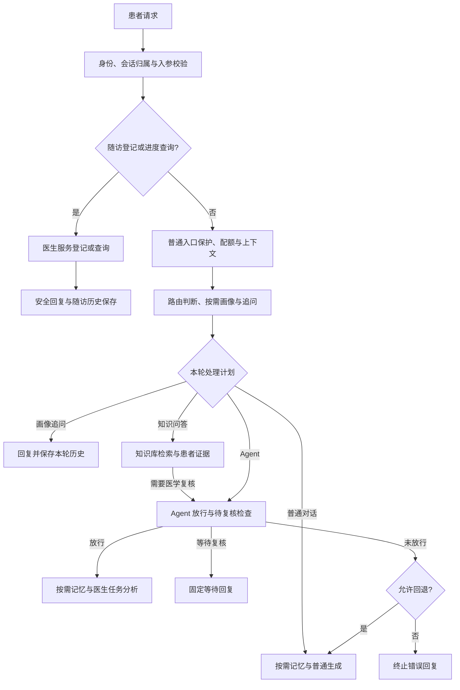
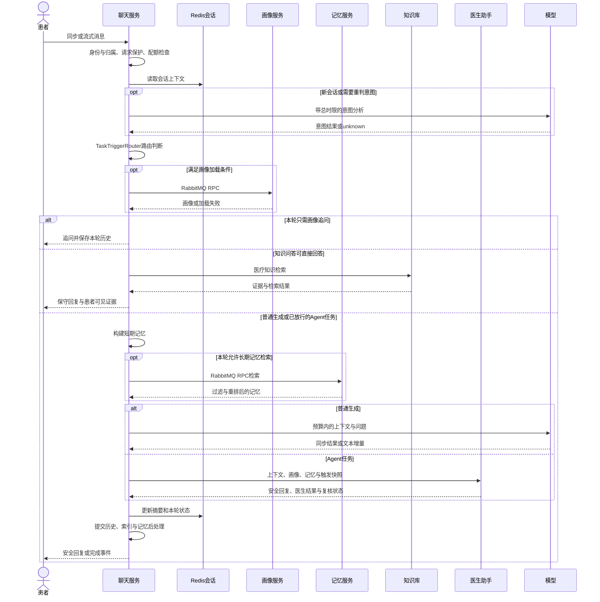

# 智能对话与医生助手整合时序

本文维护当前跨服务调用顺序、结果边界与异常分支。部署和验收遵循[单实例规范](AGENTS.md#部署范围单实例)。内部预算与幂等细节见[聊天服务说明](ai-chat-service/README.md)，设计取舍与评估方法见[学习与设计参考](学习与设计参考.md)。

## 入口与职责

| 入口或组件 | 职责 |
| --- | --- |
| `POST /api/chat`、`POST /api/chat/stream` | 校验患者身份和会话归属，分别输出同步响应与患者 SSE |
| `HighRiskFollowUpChat` | 高风险随访登记、复核进度查询；独立于普通模型链路 |
| `SessionContextService` | Redis 上下文、按需意图分析、摘要和轮次顺序保护 |
| `TaskTriggerRouter` | 根据原文与上下文产出路由决定，不直接调用医生服务 |
| `ChatTurnPolicy` | 同步与流式共用的画像追问、知识问答、Agent 放行和回退策略 |
| `LayeredMemoryOrchestrator` | 按路由需要组织短期记忆与长期记忆检索 |
| `AgentConversationRouteRuntime` | 任务放行、待复核短路、结果可消费性和失败策略 |
| `HttpDoctorAssistantAgentGateway` | 定位医生服务并携带服务间令牌调用任务分析 |
| `PatientTaskAgentService` | 将快照转为执行命令，完成 Agent 执行与患者结果转换 |
| `ChatAsyncProcessingService` | 普通对话历史、可选索引同步、长期记忆提取 |

聊天服务的基础入口见 [AiChatService](ai-chat-service/src/main/java/com/lx/governance/aichat/service/AiChatService.java) 与 [AiChatStreamService](ai-chat-service/src/main/java/com/lx/governance/aichat/service/AiChatStreamService.java)。医生任务接口虽以 `/api/patient-tasks` 开头，仍是服务间入口，需要 `X-Follow-Up-Token`，不直接开放给患者客户端。

## 请求总览

图中合并了同步和流式共有决策；两入口的执行保护细节不同，不能据此认为它们已经共享同一把会话锁。

## 普通请求时序

此图省略熔断、缓存、等待复核和终止错误的早返回；这些分支不必执行全部步骤。知识问答需要升级时，先通过 Agent 放行和待复核检查，再加载所需记忆。

## 关键分支

### 路由与画像

`TaskTriggerRouter` 优先识别高风险原文，再处理画像追问和闲聊。例如寒暄中夹带胸痛，不会被已有闲聊意图覆盖。路由命中只表示需要任务处理，实际调用还受身份、任务类型、灰度、熔断和复核状态约束。

访客、闲聊、普通事实问答和 `unknown` 意图会跳过画像加载。画像请求失败与成功读取空画像分开处理：失败时跳过自动补全；成功确认缺失时才按策略追问。意图分析总时限为 5 秒，失败保留 `unknown`，后续轮次可重判。

### 知识与记忆

知识库保存可复用医疗知识，记忆服务保存患者或群组长期信息，两者职责独立。知识问答可以直接返回患者证据；等待复核、终止错误和无需后续生成的知识回答会跳过记忆检索。

长期记忆链路为查询生成／按需改写、结构化查询校验、RPC、下游过滤与混合检索、去重和重排，再由聊天侧按预算消费。具体召回、排序与生命周期以[记忆服务说明](vector-memory-service/README.md)为准；医疗知识治理以[知识库说明](knowledge-base-service/README.md)为准。

### 医生任务与输出边界

任务请求由 `DoctorAssistantTaskRequestFactory` 打包快照。医生服务按服务端患者映射绑定责任医生；缺少映射返回 `SKIPPED` 与 `DOCTOR_NOT_ASSIGNED`，不代表复核已登记。

Agent 使用严格 JSON 协议驱动 ReAct 循环：完整解析后才能执行工具，工具访问与风险检查在执行前完成；需要审批时保存待办。患者结果经过映射、文案组合与安全清洗后返回：

- `patientSafeReply`：患者对话可见回复。
- `patientVisibleEvidence`：允许患者查看的证据。
- `structuredResult`、`doctorWorkbenchPayload`：医生侧结构化内容。

原始 Agent 增量、工具观察和医生载荷不会直接转发到患者 SSE。流式事件与审批恢复协议见[医生助手流式说明](doctor-assistant-agent/docs/医生助手智能体流式链路架构说明.md)。

### 高风险随访与进度查询

此分支先于普通上下文和模型处理。试点开启且命中风险规则时，聊天服务调用医生服务登记；仅取得持久化任务编号后确认登记。登记状态不确定时返回固定安全指引，原请求编号可重试查询远端结果。

普通复核进度查询读取当前患者、当前会话最近的持久化复核记录；页面随访卡片读取最近的高风险随访，二者查询范围不同。它们均不需要调用模型。

随访问答直接保存聊天历史并更新会话摘要，不进入长期记忆提取或 Elasticsearch 同步。同一轮重试更新原历史，临时故障不覆盖已确认结果。保存失败目前没有持久化补偿队列。操作与迁移见[随访演示](高风险随访演示.md)和[数据库指南](数据库初始化说明.md)。

### 幂等、断连与后处理

普通同步请求已支持在途共享和 Redis 成功结果回放，并用会话执行保护防止并发推进。普通流式请求已支持相同请求编号的在途共享和成功事件回放；带请求编号的客户端断连不取消共享上游，无编号调用仍在断连时取消。

随访登记和进度查询仅共享流式在途执行，不回放已完成结果，保证重试重新查询医生服务。同步与流式切换、流式不同请求编号的会话互斥仍需完善，属于单实例范围内的已知限制。

普通生成及可消费的 Agent 回复进入上下文更新和异步后处理。后处理先保存 MySQL 历史，再按配置投递 Elasticsearch 同步消息，最后触发长期记忆提取；访客跳过长期提取。线程池拒绝时尝试在调用线程保存历史和同步索引，跳过长期提取。持久化失败不能因患者已收到回复而视为成功。

预算、Token 记录、配额、回放有效期与 RPC 队列规则统一维护在[聊天服务说明](ai-chat-service/README.md)。

## 异常与验证入口

| 情况 | 当前处理或验证重点 |
| --- | --- |
| 意图失败 | 保留 `unknown`，跳过自动画像追问，高风险原文仍参与路由 |
| 画像失败 | 跳过自动补全，避免把依赖失败当成真实字段缺失 |
| 长期记忆失败 | 检索超时／降级后继续使用可用上下文 |
| Agent 未放行、失败或结果不可用 | 按 `auto-fallback-to-direct-chat` 决定回退或终止 |
| 已待复核 | 短路重复任务，进度通过持久化记录查询 |
| 流异常或缺少完成事件 | 不按完整普通回答提交历史，采集标记异常 |
| 历史、索引或记忆后处理失败 | 核对各存储结果，不能将日志或提交动作视为可靠补偿 |

单实例内的重试、并发、断连与审批用[固定回归](evaluation-service/regression/README.md)检查；外部服务联调、真实回答质量和模型调用收益按[测试分层](人工智能服务测试分层.md)分别验证。
